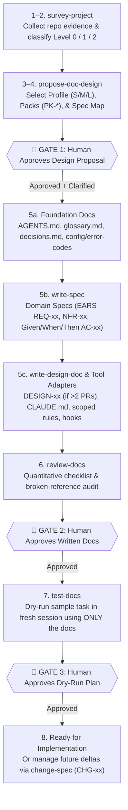

<div align="center">

# Writing Spec for AI (`writing-spec-for-ai`)

**Stop letting AI coding agents guess your architecture.**  
Turn any new or existing codebase into an evidence-backed, 3-gate specification system before a single line of application code is written.

[](https://github.com/huongmh14/writing-spec-for-ai/releases)
[](./LICENSE)
[](https://agentskills.io)
[](#installation)

<p align="center">
  <a href="#why-writing-spec-for-ai">Why This Exists</a> ·
  <a href="#features">Features</a> ·
  <a href="#installation">Installation</a> ·
  <a href="#quick-start--commands">Quick Start</a> ·
  <a href="#how-it-works--3-gate-workflow">3-Gate Workflow</a> ·
  <a href="#3-tier-base-kit-core--packs--profiles">Base Kit</a> ·
  <a href="#repository-structure">Structure</a>
</p>

<p align="center">
  <strong>English</strong> · <a href="./README.vi.md">Tiếng Việt</a>
</p>

</div>

---

## Why Writing Spec for AI?

Most AI-assisted projects fail in one of two ways: either the agent jumps straight into writing code based on unverified assumptions, or humans write a 1,500-line `AGENTS.md` that rots within two weeks and burns context window tokens on every turn.

`writing-spec-for-ai` gives your AI coding agent a disciplined engineering workflow: **Survey → Propose → Clarify → Write Specs → Self-Review → Dry-Run Test → Code**.

| Without `writing-spec-for-ai` | With `writing-spec-for-ai` |
| :--- | :--- |
| Agent starts coding immediately and hallucinates APIs, env vars, or error codes | Agent is **blocked from writing code** until 3 human approval gates pass |
| One monolithic `AGENTS.md` mixes everything and exceeds context budgets | Concise root `AGENTS.md` (`≤ 150` lines) + on-demand domain specs (`≤ 350` lines each) |
| Vague prose requirements (*"handle webhook retries gracefully"*) | Testable **EARS** requirements (`REQ-xx`), **Given/When/Then** acceptance criteria (`AC-xx`), and quantified `NFR-xx` |
| Every repository reinvents security, API, and release conventions from scratch | **3-Tier Base Kit**: inherit universal `Core` rules (`C01–C22`), attach domain `Packs` (`PK-API`, `PK-AUTH`, `PK-RELEASE`), and pick size `Profile` (`S / M / L`) |
| Specs silently drift from production code over time | Explicit spec lifecycles (`Draft` / `Approved` / `Implemented` / `Deprecated`) + delta change proposals (`CHG-xx`) |

---

## Features

<table>
<tr>
<td width="50%" valign="top">

### 🛡️ 8-Step Workflow with 3 Approval Gates
The main orchestrator skill coordinates 7 specialized sub-skills and enforces **three mandatory human checkpoints**:
1. **Gate 1 — Doc Design Proposal**: Approve the level (`0 / 1 / 2`), Profile (`S / M / L`), Packs, file tree, and spec breakdown before any docs are generated.
2. **Gate 2 — Checklist Self-Review**: Every generated file is audited against quantitative line limits, EARS syntax, and broken-link checks.
3. **Gate 3 — Dry-Run Task Verification**: The agent simulates a real task in a fresh context using only the newly written docs to expose blind spots before coding starts.

</td>
<td width="50%" valign="top">

### 🧱 3-Tier Reusable Base Kit (`Core` · `Pack` · `Profile`)
Stop copy-pasting boilerplate rules between repositories:
- **Core (`C01–C22`)**: 22 battle-tested, language-agnostic rules (security, secret hygiene, 3-state permissions, single-source-of-truth config/error registries) that apply 100% unchanged to any repo.
- **Packs (`PK-API`, `PK-AUTH`, `PK-RELEASE`)**: Opt-in domain rule modules attached only when matching signals exist in your stack.
- **Profiles (`S`, `M`, `L`)**: Scale documentation ceremony from a 3-file CLI (`S`) to a multi-service platform (`L`).

</td>
</tr>
<tr>
<td width="50%" valign="top">

### 📐 EARS Requirements & Delta Changes
- **EARS Syntax**: Every requirement follows *When / If / While / Where … the system shall …* with zero unquantified adjectives.
- **Boundary Matrix**: Every spec explicitly separates ✅ **Always Do**, ⚠️ **Ask First**, and 🚫 **Never Do**.
- **Delta Change Management (`change-spec`)**: Distinguish between adding a new sub-spec vs. mutating an existing `REQ-xx` via `CHG-xx` proposals and `P-xx → D-xx` decision promotion.

</td>
<td width="50%" valign="top">

### 🔌 Universal Multi-Agent Compatibility
Works natively out of the box across modern AI IDEs and CLI agents:
- **Google Antigravity** (`~/.gemini/config/skills/`)
- **Claude Code** (`~/.claude/skills/` & `.claude-plugin`)
- **Cursor** (`~/.cursor/skills/` & `.cursor-plugin`)
- **OpenAI Codex CLI** (`~/.codex/skills/`)
- **OpenCode** (`~/.config/opencode/skills/`)
- **ZCode** (`~/.zcode/skills/` & `.zcode-plugin`)
- **Universal `.agents`** (`~/.agents/skills/`)

</td>
</tr>
</table>

---

## Installation

### Option 1: One-Line Installer (Recommended)

Installs the full `writing-spec-for-ai` skill suite (orchestrator + 7 sub-skills + Base Kit + templates) across **Antigravity, Claude Code, Cursor, Codex, OpenCode, ZCode, and `~/.agents/skills`** simultaneously.

**Windows (PowerShell):**
```powershell
irm https://raw.githubusercontent.com/huongmh14/writing-spec-for-ai/main/install.ps1 | iex
```

**macOS / Linux / WSL:**
```bash
curl -fsSL https://raw.githubusercontent.com/huongmh14/writing-spec-for-ai/main/install.sh | bash
```

---

### Option 2: Native Plugin Marketplace (Claude Code / Cursor / ZCode)

Inside **Claude Code**:
```text
/plugin marketplace add huongmh14/writing-spec-for-ai
/plugin install writing-spec-for-ai
```

---

### Option 3: Download Pre-Packaged Skill Archives (`.zip`)

Every [GitHub Release](https://github.com/huongmh14/writing-spec-for-ai/releases) automatically builds and attaches:
- `writing-spec-for-ai-full-suite.zip` — Complete orchestrator + all 7 sub-skills + packs + templates.
- Individual self-contained skill zips (`skill-survey-project.zip`, `skill-propose-doc-design.zip`, `skill-write-spec.zip`, `skill-write-design-doc.zip`, `skill-change-spec.zip`, `skill-review-docs.zip`, `skill-test-docs.zip`) if you want to install a single sub-skill standalone.

---

### Option 4: Manual Clone & Copy

Clone the repository and copy it into your preferred agent's global or workspace skill directory (keep the directory structure intact so relative references between sub-skills, `references/`, `packs/`, and `templates/` resolve cleanly):

```bash
git clone https://github.com/huongmh14/writing-spec-for-ai.git
```

| AI Agent / IDE | Global Skills Path | Workspace (Per-Repo) Path |
| :--- | :--- | :--- |
| **Antigravity** | `~/.gemini/config/skills/writing-spec-for-ai/` | `<repo>/.agents/skills/writing-spec-for-ai/` |
| **Claude Code** | `~/.claude/skills/writing-spec-for-ai/` | `<repo>/.claude/skills/writing-spec-for-ai/` |
| **Cursor** | `~/.cursor/skills/writing-spec-for-ai/` | `<repo>/.cursor/skills/writing-spec-for-ai/` |
| **Codex CLI** | `~/.codex/skills/writing-spec-for-ai/` | `<repo>/.agents/skills/writing-spec-for-ai/` |
| **OpenCode** | `~/.config/opencode/skills/writing-spec-for-ai/` | `<repo>/.agents/skills/writing-spec-for-ai/` |
| **ZCode** | `~/.zcode/skills/writing-spec-for-ai/` | `<repo>/.zcode/skills/writing-spec-for-ai/` |

---

## Quick Start & Commands

### Full End-to-End Workflow (Orchestrator)

Open your project in your AI coding agent and prompt:

```text
Use skill writing-spec-for-ai to survey this repository and design the AI documentation suite.
```

The agent will inspect your codebase, classify its complexity, select a **Profile (`S / M / L`)** and matching **Domain Packs (`PK-*`)**, and stop at **Gate 1** with a complete `doc-design-proposal.md` for your review.

### Calling Individual Sub-Skills Directly

You don't have to run all 8 steps every time. Invoke any of the 7 sub-skills directly when you need a targeted action:

| Skill Name | When to Use | Example Prompt |
| :--- | :--- | :--- |
| **`writing-spec-for-ai`** | Full 8-step orchestrator across 3 approval gates | *"Use `writing-spec-for-ai` to set up AI specs and AGENTS.md for this project."* |
| **`survey-project`** | Steps 1–2: Audit an existing or greenfield repo with file/command evidence | *"Use `survey-project` to audit this repo and classify its doc maturity level."* |
| **`propose-doc-design`** | Steps 3–4 (Gate 1): Propose `S/M/L` profile, `PK-*` packs, and spec breakdown | *"Use `propose-doc-design` to propose a spec architecture for our billing service."* |
| **`write-spec`** | Step 5b: Author a single domain spec (`REQ-xx` EARS, `NFR-xx`, `AC-xx`) | *"Use `write-spec` to write `SPEC-webhook-delivery`."* |
| **`write-design-doc`** | Step 5c: Write a technical design doc (`DESIGN-xx`) for changes `> 2 PRs` or touching schema/auth | *"Use `write-design-doc` to design the database migration for `SPEC-auth`."* |
| **`change-spec`** | Manage spec evolution: new sub-spec vs. `CHG-xx` delta proposal & `P-xx → D-xx` | *"Use `change-spec` to update `SPEC-upload` rate limits from 100/m to 500/m."* |
| **`review-docs`** | Step 6 (Gate 2): Audit generated docs against the quantitative checklist | *"Use `review-docs` to audit `AGENTS.md` and `docs/specs/`."* |
| **`test-docs`** | Step 7 (Gate 3): Dry-run a sample engineering task in a clean context using only the docs | *"Use `test-docs` to dry-run a sample task against our new specs."* |

---

## How It Works — 3-Gate Workflow



---

## 3-Tier Base Kit (`Core` → `Packs` → `Profiles`)

To maximize reuse across all your projects while staying flexible for any tech stack, `writing-spec-for-ai` separates rules into three layers (documented in [`references/base-kit.md`](./references/base-kit.md) and [`profiles.md`](./profiles.md)):

### 1. Tier 1 — Core Rules (`C01–C22`)
100% universal rules inherited by every project regardless of language or framework:
- **Structure & Lifecycle (`C01–C06`)**: Progressive disclosure (`AGENTS.md ≤ 150` lines), spec lifecycle states (`Draft` / `Approved` / `Implemented` / `Deprecated`), `P-xx → D-xx` decision tracking, delta `CHG-xx` workflow, and single-source-of-truth registries for environment variables (`docs/reference/config.md`) and error codes (`docs/reference/error-codes.md`).
- **Execution & Safety (`C07–C12`)**: 3-state autonomy boundaries (✅ Always / ⚠️ Ask First / 🚫 Never), verify-after-edit command loops, scope discipline, and structured multi-session handoffs (`HANDOFF.md`).
- **Security & Secret Hygiene (`C13–C17`)**: Zero secrets in git/logs, `.env.example` synchronization, trust-boundary input validation, least-privilege permissions, and dependency lockfile justification.
- **Spec Authoring Quality (`C18–C22`)**: EARS syntax for `REQ-xx`, quantified `NFR-xx` metrics, Given/When/Then `AC-xx` (happy + error + edge cases), and zero real credentials in documentation examples.

### 2. Tier 2 — Domain Packs (`packs/PK-*.md`)
Opt-in domain rule sets attached at **Gate 1** based on repository signals:

| Pack ID | Domain | Trigger Signals | Key Rules Included |
| :--- | :--- | :--- | :--- |
| **[`PK-API`](./packs/PK-API.md)** | HTTP / REST / Webhook API | Web routers, controllers, OpenAPI, webhook handlers | Unified error envelope, explicit timeouts (`REQ`/`NFR`), idempotency keys, pagination bounds (`limit ≤ Max`), `/health` & `/ready` probes, rate-limit headers |
| **[`PK-AUTH`](./packs/PK-AUTH.md)** | Tokens, Keys & Signatures | JWT/OAuth, API keys, HMAC webhooks, password hashing | Constant-time comparison, asymmetric/rotatable key verification (`kid`), log redaction (`Authorization`, `token`, `secret`), webhook timestamp replay window |
| **[`PK-RELEASE`](./packs/PK-RELEASE.md)** | Containers & Release | `Dockerfile`, `docker-compose`, CI/CD release workflows | Pinned base images, non-root runtime user, zero secrets in image layers, SemVer tag discipline, automated `CHANGELOG.md` + `docs/upgrade/` guides |

*(Planned roadmap packs in `v1.2+`: `PK-DB`, `PK-STREAM`, `PK-CLI-AGENT`, `PK-FE`.)*

### 3. Tier 3 — Project Size Profiles ([`profiles.md`](./profiles.md))

| Profile | Target Project Size | Included Artifacts | Gate Ceremony |
| :--- | :--- | :--- | :--- |
| **`S` (Small)** | CLI tools, scripts, prototypes (`< 5` code files, 1 dev, no DB) | `AGENTS.md` (`≤ 80` lines), `docs/decisions.md`, 1 `SPEC-<core>.md` (3 files total) | **2 Gates** (Gate 2 + Gate 3 combined) |
| **`M` (Medium)** | Standard production services, web apps, bots (`1–3` services) | Full Level 1 + selected Level 2 (`glossary.md`, `config.md`, `error-codes.md`, `1–5` domain specs, `DESIGN-xx` when `> 2 PRs`) | **3 Full Gates** |
| **`L` (Large)** | Multi-service platforms, monorepos, high-compliance systems | Full Level 2 + `adr/`, `upgrade/`, `changelog/`, scoped directory rules, deny hooks, review subagent | **3 Full Gates + mandatory `review-docs` & `test-docs`** |

> **Override Mechanism:** Any project can override a `Core` or `Pack` rule without editing the base kit by recording a decision `D-xx` in `docs/decisions.md` with `[Overrides: C10 | PK-API-04]` plus rationale and expiration/review condition. Precedence is strictly: **`D-xx` (Project Override) > `Pack` > `Core`**.

---

## Repository Structure

```text
writing-spec-for-ai/
├── SKILL.md                         # Main Orchestrator Skill (8 steps, 3 approval gates)
├── profiles.md                      # S / M / L project size presets & upgrade triggers
├── CHANGELOG.md                     # Base Kit version history & rule ID registry
├── LICENSE                          # MIT License
├── install.ps1 / install.sh         # One-line cross-agent installers (Windows / macOS / Linux)
├── skills/                          # 7 Specialized Sub-Skills
│   ├── survey-project/SKILL.md      #   Steps 1–2: Evidence-backed repo survey & Level 0/1/2 sizing
│   ├── propose-doc-design/SKILL.md  #   Steps 3–4: Doc architecture & spec breakdown (Gate 1)
│   ├── write-spec/SKILL.md          #   Step 5b: Author domain spec (EARS, NFR, Given/When/Then)
│   ├── write-design-doc/SKILL.md    #   Step 5c: Technical design doc (DESIGN-xx)
│   ├── change-spec/SKILL.md         #   Spec evolution: sub-spec vs. CHG-xx delta proposal
│   ├── review-docs/SKILL.md         #   Step 6: Checklist & line-budget audit (Gate 2)
│   └── test-docs/SKILL.md           #   Step 7: Fresh-session dry-run task verification (Gate 3)
├── packs/                           # Tier 2 Domain Rule Packs
│   ├── PK-API.md                    #   HTTP API, webhooks, pagination, health probes, timeouts
│   ├── PK-AUTH.md                   #   Tokens, signing keys, constant-time verify, redaction
│   └── PK-RELEASE.md                #   Docker hardening, SemVer tags, upgrade guides
├── references/                      # Deep Engineering References
│   ├── principles.md                #   Progressive disclosure, EARS grammar, multi-agent matrix
│   ├── base-kit.md                  #   Core rules registry (C01–C22), Pack architecture, override rules
│   ├── examples.md                  #   Real-world production examples (REQ, AC, NFR, D-xx, plans)
│   └── review-checklist.md          #   Gate 2 & Gate 3 quantitative audit rubric
├── templates/                       # Ready-to-Use Document & Adapter Templates
│   ├── doc-design-proposal.md       #   Gate 1 proposal template (with Base Kit metadata header)
│   ├── AGENTS.md                    #   Root agent instructions template (≤ 150 lines)
│   ├── docs/                        #   Templates for specs, designs, changes, plans, ADR, glossary,
│   │                                #   decisions, progress, upgrade, changelog, config, error-codes
│   ├── adapters/                    #   CLAUDE.md, copilot-instructions.md, scoped-rules.md,
│   │                                #   claude-settings.json, pull_request_template.md, subagent.md
│   └── project-skill/SKILL.md       #   Template for generating repo-specific skills
└── .claude-plugin/                  # Native plugin manifests (.claude, .cursor, .copilot, .zcode)
```

---

## Contributing

Contributions, new domain packs (`PK-DB`, `PK-STREAM`, `PK-CLI-AGENT`, `PK-FE`), and real-world case studies are welcome!
1. Fork the repository and create your branch.
2. Ensure all skill files stay within token-efficient line budgets (`SKILL.md ≤ 150` lines) and follow the Core (`C01–C22`) / Pack (`PK-*`) ID conventions in [`references/base-kit.md`](./references/base-kit.md).
3. Run the `review-docs` checklist before opening a Pull Request.

---

## License

Released under the [MIT License](./LICENSE). Copyright © 2026 [huongmh14](https://github.com/huongmh14).
