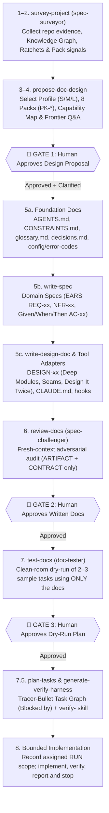

<div align="center">

# Writing Spec for AI (`writing-spec-for-ai`)

**Stop letting AI coding agents guess your architecture.**  
Turn any new or existing codebase into an evidence-backed, 3-gate specification system before a single line of application code is written.

[](https://github.com/huongmh14/writing-spec-for-ai/releases)
[](./LICENSE)
[](https://agentskills.io)
[](#installation)

<p align="center">
  <a href="#why-writing-spec-for-ai">Why This Exists</a> ·
  <a href="#features">Features</a> ·
  <a href="#installation">Installation</a> ·
  <a href="#quick-start--commands">Quick Start</a> ·
  <a href="#how-it-works--3-gate-workflow">3-Gate Workflow</a> ·
  <a href="#3-tier-base-kit-core--packs--profiles">Base Kit (31 Core + 8 Packs)</a> ·
  <a href="#repository-structure">Structure</a>
</p>

<p align="center">
  <strong>English</strong> · <a href="./README.vi.md">Tiếng Việt</a>
</p>

</div>

**Unreleased design update (2026-10-25):** `Ready` approves requirements; execution follows the user's actual bounded assignment. Default to one spec and one verifiable task, run an independent/cross-model critique (`Writer → Codex / spec-challenger → Self-Fix`, `C26`), report evidence with a plain-language technical explanation, and stop. Honor explicitly assigned finite batches without repeated approval. Users review behavior and trade-offs; agents must source or verify technical claims and disclose unknowns (`C30–C31`). Each important claim carries one of four provenance labels — `Người dùng chốt` (user-decided), `Đã xác minh` (verified: one openable pointer + verbatim quote), `AI đề xuất` (AI-proposed), `Chưa biết` (unknown). Technical mechanisms and decisions come with a visible **Technical Explanation & Decision Card** (*Plain-language essence + example · Why needed / what breaks without it · Input → Process → Output flow · ≤ 5-minute runnable self-check · Source & expert boundary*) so users genuinely understand the technical concepts while verifying correctness through the observable self-check; security/payment/legal/personal-data areas are flagged "needs an expert". Kit terms and domain-pack mechanisms are explained in [references/glossary.md](references/glossary.md).

Read the [research and primary sources](references/research-controlled-execution.md), [before/after walkthrough](references/controlled-spec-demo.md), and [updated spec template](templates/docs/specs/_template.md). Markdown guides behavior; tool permissions and sandboxes provide enforcement.

---

## Why Writing Spec for AI?

Most AI-assisted projects fail in one of two ways: either the agent jumps straight into writing code based on unverified assumptions, or humans write a 1,500-line `AGENTS.md` that rots within two weeks and burns context window tokens on every turn.

`writing-spec-for-ai` gives your AI coding agent a disciplined engineering workflow: **Survey → Propose → Clarify → Write Specs → Adversarial Self-Review → Clean-Room Dry-Run → Tracer-Bullet Plan → Code**.

| Without `writing-spec-for-ai` | With `writing-spec-for-ai` |
| :--- | :--- |
| Agent starts coding immediately and hallucinates APIs, env vars, or error codes | Agent is **blocked from writing code** until 3 human approval gates pass |
| One monolithic `AGENTS.md` mixes everything and exceeds context budgets | Concise root `AGENTS.md` (`≤ 150` lines) with front-loaded **Context Pointers (`C24`)** + on-demand domain specs |
| Agent quietly adds `@ts-ignore`, `eslint-disable`, or `.skip` to force CI green | **Floor Guard & Ratchets (`C23` + `CONSTRAINTS.md`)** block suppression comments and quality regressions |
| Vague prose requirements (*"handle webhook retries gracefully"*) that humans rubber-stamp without picturing the product | **Visual Direction (`C28`)** (`🟢 Now / 🟡 Next / 🔴 Not Doing` Scope Radar, Mermaid flows, ASCII UI wireframes/JSON snapshots) + testable **EARS** `REQ-xx` |
| Opaque background testing where the agent says *"All tests passed"* while mocking out real logic | **Visible Testing (`C29`)**: Pre-Code **Visible Test Matrix** + Post-Run **Test Execution Ledger** with explicit **Mock Disclosure (`0 Mock` vs. mocked boundary)** |
| Every repository reinvents security, API, DB, UI, and agent conventions | **3-Tier Base Kit**: inherit 31 `Core` rules (`C01–C31`), attach 8 domain `Packs` (`PK-*`), and pick size `Profile` (`S / M / L`) |
| Author agent reviews its own specs with confirmation bias | **3 Native Subagents** (`spec-surveyor`, `spec-challenger`, `doc-tester`) isolate context and perform adversarial review |

---

## Features

<table>
<tr>
<td width="50%" valign="top">

### 🛡️ 8-Step Workflow with 3 Approval Gates
The main orchestrator coordinates **9 specialized sub-skills** and **3 clean-context subagents** across three mandatory human checkpoints:
1. **Gate 1 — Doc Design Proposal**: Approve the Profile (`S / M / L`), Packs (`PK-*`), Capability Map (`Depends on` + `Build Order`), and file tree before any docs are generated.
2. **Gate 2 — Adversarial Checklist Review**: `spec-challenger` audits generated files in a fresh context (`ARTIFACT + CONTRACT` only) against EARS syntax, line budgets, and broken links.
3. **Gate 3 — Clean-Room Dry-Run**: `doc-tester` simulates real engineering tasks in a fresh session using *only* the newly written docs to expose blind spots before coding starts.

</td>
<td width="50%" valign="top">

### 🧱 3-Tier Reusable Base Kit (`Core` · `8 Packs` · `Profiles`)
Stop copy-pasting boilerplate rules between repositories:
- **Core (`C01–C31`)**: 31 universal rules (progressive disclosure, EARS, Floor Guard & Ratchets, Context Pointers, Official Source Citations, Adversarial Doubt, Ceiling Markers, Visual Direction & Option Cards, Visible Test Ledger).
- **8 Domain Packs (`packs/PK-*.md`)**: `PK-API`, `PK-AUTH`, `PK-RELEASE`, `PK-DB`, `PK-OBS`, `PK-FE`, `PK-JOB`, `PK-AGENT`.
- **Profiles (`S`, `M`, `L`)**: Scale ceremony from a 3-file script (`S`) to a multi-service monorepo (`L`) with `CONSTRAINTS.md` and `verify-<app>` harnesses.

</td>
</tr>
<tr>
<td width="50%" valign="top">

### 📐 Deep Modules, Tracer Bullets & Verification Harnesses
- **Evidence-Based Frontier Interviews**: `propose-doc-design` states `HYPOTHESIS + EVIDENCE + GAPS` and asks at most three questions about observable behavior, scope and trade-offs. Technical details can be delegated and verified.
- **Deep Modules & Design It Twice (`write-design-doc`)**: Enforces high interface depth, explicit test seams, and official framework documentation citations (`C25`).
- **Tracer-Bullet Task Graphs (`plan-tasks`) & Runtime Verification (`generate-verify-harness`)**: Slice approved specs into parallelizable vertical slices (`Blocked by`) and generate `.agents/skills/verify-<app>/SKILL.md` harnesses.

</td>
<td width="50%" valign="top">

### 🔌 Universal Multi-Agent Compatibility
Works natively out of the box across modern AI IDEs and CLI agents:
- **Google Antigravity** (`~/.gemini/config/skills/`)
- **Claude Code** (`~/.claude/skills/`, `~/.claude/agents/`, `.claude-plugin`)
- **Cursor** (`~/.cursor/skills/`, `~/.cursor/agents/`, `.cursor-plugin`)
- **OpenAI Codex CLI** (`~/.codex/skills/`)
- **OpenCode** (`~/.config/opencode/skills/`)
- **ZCode** (`~/.zcode/skills/` & `.zcode-plugin`)
- **Universal `.agents`** (`~/.agents/skills/` & `~/.agents/agents/`)

</td>
</tr>
</table>

---

## Installation

### Option 1: One-Line Installer (Recommended)

Installs the full `writing-spec-for-ai` skill suite (orchestrator + 9 sub-skills + 8 Domain Packs + templates) AND the **3 specialized subagents (`spec-surveyor`, `spec-challenger`, `doc-tester`)** across **Antigravity, Claude Code, Cursor, Codex, OpenCode, ZCode, and `~/.agents`** simultaneously.

**Windows (PowerShell):**
```powershell
irm https://raw.githubusercontent.com/huongmh14/writing-spec-for-ai/main/install.ps1 | iex
```

**macOS / Linux / WSL:**
```bash
curl -fsSL https://raw.githubusercontent.com/huongmh14/writing-spec-for-ai/main/install.sh | bash
```

Default install is **lean**: sub-skills ship nested as `writing-spec-for-ai/skills/<name>/sub-skill.md`, so all agents—including recursive `SKILL.md` scanners like Codex and OpenCode—preload only the single orchestrator description (~0.8k–1.1k fewer tokens per turn). Need direct `/write-spec`, `/review-docs`…? Re-run with `-Standalone` (PowerShell: `& ([scriptblock]::Create((irm <url>))) -Standalone`) or `bash -s -- --standalone`. Evidence: [references/research-token-budget.md](references/research-token-budget.md).

---

### Option 2: Native Plugin Marketplace (Claude Code / Cursor / ZCode)

Inside **Claude Code**:
```text
/plugin marketplace add huongmh14/writing-spec-for-ai
/plugin install writing-spec-for-ai
```

---

### Option 3: Download Pre-Packaged Skill Archives (`.zip`)

Every [GitHub Release](https://github.com/huongmh14/writing-spec-for-ai/releases) automatically builds and attaches:
- `writing-spec-for-ai-full-suite.zip` — Complete orchestrator + all 9 sub-skills + 3 subagents + 8 packs + templates.
- Individual self-contained skill zips (`skill-survey-project.zip`, `skill-propose-doc-design.zip`, `skill-write-spec.zip`, `skill-write-design-doc.zip`, `skill-change-spec.zip`, `skill-review-docs.zip`, `skill-test-docs.zip`, `skill-plan-tasks.zip`, `skill-generate-verify-harness.zip`).

---

### Option 4: Manual Clone & Copy

```bash
git clone https://github.com/huongmh14/writing-spec-for-ai.git
```

| AI Agent / IDE | Global Skills Path | Workspace (Per-Repo) Path |
| :--- | :--- | :--- |
| **Antigravity** | `~/.gemini/config/skills/writing-spec-for-ai/` | `<repo>/.agents/skills/writing-spec-for-ai/` |
| **Claude Code** | `~/.claude/skills/writing-spec-for-ai/` | `<repo>/.claude/skills/writing-spec-for-ai/` |
| **Cursor** | `~/.cursor/skills/writing-spec-for-ai/` | `<repo>/.cursor/skills/writing-spec-for-ai/` |
| **Codex CLI** | `~/.codex/skills/writing-spec-for-ai/` | `<repo>/.agents/skills/writing-spec-for-ai/` |
| **OpenCode** | `~/.config/opencode/skills/writing-spec-for-ai/` | `<repo>/.agents/skills/writing-spec-for-ai/` |
| **ZCode** | `~/.zcode/skills/writing-spec-for-ai/` | `<repo>/.zcode/skills/writing-spec-for-ai/` |

---

## Quick Start & Commands

### Full End-to-End Workflow (Orchestrator)

Open your project in your AI coding agent and prompt:

```text
Use skill writing-spec-for-ai to survey this repository and design the AI documentation suite.
```

### Calling Individual Sub-Skills & Subagents Directly

| Skill / Subagent | Role | Example Prompt |
| :--- | :--- | :--- |
| **`writing-spec-for-ai`** | Main 8-step orchestrator across 3 approval gates | *"Use `writing-spec-for-ai` to set up AI specs and AGENTS.md for this project."* |
| **`survey-project`** *(+ `spec-surveyor`)* | Steps 1–2: Audit repo evidence, Knowledge Graph (`.ua/`), CI alignment, baseline ratchets, and pack signals | *"Use `survey-project` to audit this repo and classify its profile and packs."* |
| **`propose-doc-design`** | Steps 3–4 (Gate 1): Propose `S/M/L` profile, `PK-*` packs, Capability Map, and Frontier `HYPOTHESIS/GUESS` questions | *"Use `propose-doc-design` to propose a spec architecture for our service."* |
| **`write-spec`** | Step 5b: Author a domain spec (`REQ-xx` EARS, 8-row `NFR-xx`, Given/When/Then `AC-xx`) | *"Use `write-spec` to write `SPEC-webhook-delivery`."* |
| **`write-design-doc`** | Step 5c: Author `DESIGN-xx` (Deep Modules, Seams, Design It Twice, `C25` citations, `C27` ceiling markers) | *"Use `write-design-doc` to design the database migration for `SPEC-auth`."* |
| **`review-docs`** *(+ `spec-challenger`)* | Step 6 (Gate 2): Fresh-context adversarial checklist review (`ARTIFACT + CONTRACT` only) | *"Use `review-docs` to run an adversarial audit on `AGENTS.md` and `docs/specs/`."* |
| **`test-docs`** *(+ `doc-tester`)* | Step 7 (Gate 3): Clean-room dry-run of 2–3 sample tasks (Profile S: 2; M/L: 3) using only the written docs | *"Use `test-docs` to dry-run sample tasks against our new specs."* |
| **`plan-tasks`** | Step 7.5: Break an approved spec into a DAG of Tracer-Bullet vertical slices (`Blocked by` + ready tasks) | *"Use `plan-tasks` to break `SPEC-auth` into tracer-bullet implementation tasks."* |
| **`generate-verify-harness`** | Generate a project-local `.agents/skills/verify-<app>/SKILL.md` runtime verification skill | *"Use `generate-verify-harness` to create an automated verification skill for this app."* |
| **`explore-options`** | Any decision with ≥ 2 viable, hard-to-reverse options: 2–4 genuinely different options from signal-selected lenses (`references/lenses.md`), one critique round, comparison table — the user chooses, recorded as `D-xx` | *"Use `explore-options` to compare session storage approaches for SPEC-auth."* |
| **`change-spec`** | Manage spec evolution: new sub-spec vs. `CHG-xx` delta proposal & `P-xx → D-xx` | *"Use `change-spec` to update `SPEC-upload` rate limits from 100/m to 500/m."* |

---

## How It Works — 3-Gate Workflow



---

## 3-Tier Base Kit (`Core` → `Packs` → `Profiles`)

### 1. Tier 1 — Core Rules (`C01–C31`)
31 universal rules inherited by every project (documented in [`references/base-kit.md`](./references/base-kit.md)):
- **Structure, Truth & Lifecycle (`C01–C11`)**: Truth hierarchy (`decisions > specs > CONSTRAINTS > AGENTS > code`), 3 approval gates, AI permissions by spec status (`C03`), EARS + Given/When/Then traceability (`C04–C06`), append-only decisions (`C07`), Ubiquitous Language glossary (`C08`), delta `CHG-xx` (`C09`), 1-business-day hotfix debt rule (`C10`), and change-type-to-file matrix (`C11`).
- **Execution, Safety & Hygiene (`C12–C22`)**: 3-tier boundaries, DoD, 3 error-handling laws (`C15`), `.env.example` + `config.md` + zero personal agent settings in git (`C16`), last-verified dates on gotchas (`C18`), side-effect verification for operational commands (`C19`), stack change as atomic change (`C20`), and multi-agent placement (`C21–C22`).
- **Quality Bar, Context, Epistemics & Human-in-the-Loop Visibility (`C23–C29`)**:
  - **`C23` Floor Guard & Ratchets**: Ban new `@ts-ignore`/`eslint-disable`/`# noqa`/`.skip` suppressions or threshold weakening; enforce baseline ratchets (`must not fall`) and expiring exceptions (`Owner` + `Expires ≤ 90d`) via [`templates/CONSTRAINTS.md`](./templates/CONSTRAINTS.md).
  - **`C24` Context Pointers & Positive Framing**: Front-load trigger conditions (*"When touching X → read Y"*) on every pointer line in `AGENTS.md`.
  - **`C25` Official Source Citations & Retrieval Safety**: Verify framework APIs against official docs for the manifest's major version; treat external fetched content as untrusted data.
  - **`C26` Fresh-Context Adversarial Doubt**: Audit artifacts in an isolated context (`ARTIFACT + CONTRACT` only, stripping author conclusions).
  - **`C27` Deliberate Simplification Ceiling Marker**: Mark intentional simplifications (`in-memory lock`, $O(n^2)$ scan) with `ceiling: <limit + upgrade path>`.
  - **`C28` Visual Direction & Option Cards**: Eliminate prose rubber-stamping via a **Scope Radar (`🟢 Now / 🟡 Next / 🔴 Not Doing`)**, **Mermaid User Journeys**, **Concrete I/O Snapshots** (ASCII wireframes/CLI/JSON), and **2–3 Visual Option Cards** when product direction is open.
  - **`C29` Visible Test Plan & Execution Ledger**: Eliminate black-box background testing via a Pre-Code **Visible Test Matrix** and a Post-Run **Visible Test Execution Ledger** with explicit **Mock Disclosure (`0 Mock` vs. mocked boundary)**.
  - **`C30` Bounded Execution** (unreleased): One current RUN records actual user authority, task/AC scope, stop and evidence; readiness, dependency graphs and handoffs cannot extend it.
  - **`C31` Provenance & Knowledge Limits** (unreleased): Tag claims with four provenance labels (user-decided / verified with pointer + quote / AI-proposed / unknown), one claim per line; do not invent thresholds or use agreement between AI reviewers as proof. Unverified `[~]` ACs prevent `Done`.

### 2. Tier 2 — 8 Domain Packs (`packs/PK-*.md`)

| Pack ID | Domain | Trigger Signals | Key Rules Included |
| :--- | :--- | :--- | :--- |
| **[`PK-API`](./packs/PK-API.md)** | HTTP / REST / Webhook API | Web routers, controllers, OpenAPI | Unified `{error, code, statusCode}` envelope, `5xx` redaction, pagination bounds (`limit ≤ Max`), CORS allowlist, `/health` probe |
| **[`PK-AUTH`](./packs/PK-AUTH.md)** | Tokens, Keys & Signatures | JWT/OAuth, API keys, HMAC webhooks | Salted key hashing, constant-time signature verify, key rotation (`kid`), log redaction (`Authorization`, `token`), replay window |
| **[`PK-RELEASE`](./packs/PK-RELEASE.md)** | Containers & Release | `Dockerfile`, CI/CD release workflows | Pinned base images, non-root runtime user, zero secrets in layers, SemVer tag discipline, rebuilt dist artifacts (`PK-RELEASE-R06`) |
| **[`PK-DB`](./packs/PK-DB.md)** | Database, Schema & Migration | SQL/NoSQL DB, ORM, `migrations/` | **Expand–Migrate–Contract** (verification happens inside Migrate), idempotent migrate/seed with non-zero failure exit, zero external HTTP inside open DB transactions, bounded batch queries |
| **[`PK-OBS`](./packs/PK-OBS.md)** | Observability, Logs & Metrics | Long-running services, on-call alerts | Structured JSON logs with `event`, mandatory `requestId` + `entryPoint` (`http`/`scheduler`/`queue`/`cli`) propagation, bounded-cardinality RED metrics, symptom alerts linked to 3-line runbooks |
| **[`PK-FE`](./packs/PK-FE.md)** | Frontend UI, A11y & E2E | Web/Desktop UI, React/Vue/Quasar | Mandatory 4-state UI (`loading`/`empty`/`error`/`data`), Design Tokens (`{tokens-path}`), WCAG 2.2 AA (`axe-core`), Core Web Vitals (`LCP`/`CLS`), non-flaky Playwright role/label locators |
| **[`PK-JOB`](./packs/PK-JOB.md)** | Background Jobs, Queues & Cron | Workers, queues, cron, daemons | Business-key idempotency (`PK-JOB-R01`), bounded timeouts + jittered backoff, Dead-Letter Queue (DLQ) isolation, atomic CAS lease locks with TTL, `SIGTERM` graceful shutdown |
| **[`PK-AGENT`](./packs/PK-AGENT.md)** | AI Agent Orchestration & Sandbox | LLM/CLI harnesses, MCP servers, bots | Deterministic hard-refuse policy (`policy.js`), least-privilege sandboxes (`read-only` surveyors vs. isolated worktree implementers), `{max-turns}` loop bounds, indirect prompt-injection framing, 429 failover without unauthorized paid fallback |

### 3. Tier 3 — Project Size Profiles ([`profiles.md`](./profiles.md))

| Profile | Target Project Size | Included Artifacts | Gate Ceremony |
| :--- | :--- | :--- | :--- |
| **`S` (Small)** | CLI scripts, infra configs (`< ~30` files, no public API) | `AGENTS.md` (`≤ 60` lines), `README.md`, `.env.example`, optional single `docs/spec.md` |Lightweight |
| **`M` (Medium)** | Production services, web apps, bots (`~30–200` files) | Full Level 0 (`C01–C31`) + `CONSTRAINTS.md` (Level 1, only when signals call for it) + `docs/specs/` (with Capability Map, Visual Flows & Visible Test Matrix) + matching `PK-*` packs + CI DoD | **3 Full Gates** |
| **`L` (Large)** | Multi-service platforms, monorepos (`> 200` files) | Full Profile M + mandatory `CONSTRAINTS.md`, `docs/architecture/`, `docs/upgrade/`, `.agents/skills/verify-<app>/`, scoped rules, hooks, CODEOWNERS | **3 Full Gates + `spec-challenger` & `doc-tester`** |

File counts and line budgets are kit conventions, only a hint; signals (team size, CI, risk areas, number of specs) decide.

---

## Repository Structure

```text
writing-spec-for-ai/
├── SKILL.md                             # Main Orchestrator Skill (8 steps, 3 approval gates)
├── profiles.md                          # S / M / L project size presets & upgrade triggers
├── CHANGELOG.md                         # Base Kit version history & rule ID registry
├── LICENSE                              # MIT License
├── install.ps1 / install.sh             # One-line cross-agent installers (skills + subagents)
├── skills/                              # 9 Specialized Sub-Skills
│   ├── survey-project/SKILL.md          #   Steps 1–2: Evidence survey, Knowledge Graph & Ratchets
│   ├── propose-doc-design/SKILL.md      #   Steps 3–4: Capability Map & Frontier Q&A (Gate 1)
│   ├── write-spec/SKILL.md              #   Step 5b: Domain spec (EARS, 8-row NFR, Given/When/Then)
│   ├── write-design-doc/SKILL.md        #   Step 5c: Deep Modules, Seams, Design It Twice (DESIGN-xx)
│   ├── change-spec/SKILL.md             #   Spec evolution: sub-spec vs. CHG-xx delta proposal
│   ├── review-docs/SKILL.md             #   Step 6: Adversarial checklist audit (Gate 2)
│   ├── test-docs/SKILL.md               #   Step 7: Clean-room dry-run task verification (Gate 3)
│   ├── plan-tasks/SKILL.md              #   Step 7.5: Tracer-Bullet vertical slices & Task Graph DAG
│   ├── generate-verify-harness/SKILL.md #   Runtime verification skill generator (verify-<app>)
│   └── explore-options/SKILL.md         #   Multi-lens options, user chooses -> D-xx
├── agents/                              # 3 Native Clean-Context Subagents
│   ├── spec-surveyor.md                 #   Read-only repository evidence & pack signal scanner
│   ├── spec-challenger.md               #   Adversarial Gate 2 reviewer (ARTIFACT + CONTRACT only)
│   └── doc-tester.md                    #   Clean-room Gate 3 dry-run developer simulator
├── packs/                               # 8 Tier-2 Domain Rule Packs
│   ├── PK-API.md                        #   HTTP API, error envelope, pagination, CORS, health probes
│   ├── PK-AUTH.md                       #   Tokens, signing keys, constant-time verify, redaction
│   ├── PK-RELEASE.md                    #   Docker hardening, SemVer tags, artifact sync
│   ├── PK-DB.md                         #   Expand–Migrate–Contract migrations, idempotent seed, N+1 & tx bounds
│   ├── PK-OBS.md                        #   Structured JSON logs, correlationId + entryPoint, RED metrics
│   ├── PK-FE.md                         #   4-state UI, Design Tokens, WCAG 2.2 AA, Playwright E2E
│   ├── PK-JOB.md                        #   Idempotent jobs, backoff + DLQ, CAS leases, SIGTERM shutdown
│   └── PK-AGENT.md                      #   Hard-refuse policy, read-only sandbox, prompt-injection defense
├── references/                          # Deep Engineering References
│   ├── principles.md                    #   Progressive disclosure, EARS grammar, multi-agent matrix
│   ├── base-kit.md                      #   Core rules registry (C01–C31), Pack architecture, override rules
│   ├── examples.md                      #   Real-world production examples (REQ, AC, NFR, D-xx, plans)
│   ├── glossary.md                      #   Kit terms in plain words (Gate, Profile, Pack, Frontier, EARS…)
│   ├── lenses.md                        #   Expert lenses chosen by signal (replaces "act as senior X")
│   └── review-checklist.md              #   Gate 2 & Gate 3 quantitative audit rubric
├── templates/                           # Ready-to-Use Document & Adapter Templates
│   ├── doc-design-proposal.md           #   Gate 1 proposal template
│   ├── AGENTS.md                        #   Root agent instructions template (≤ 150 lines)
│   ├── CONSTRAINTS.md                   #   Machine-checked quality floor, ratchets & expiring exceptions
│   ├── docs/                            #   Templates for specs, designs, changes, plans, ADR, glossary,
│   │                                    #   decisions, progress, upgrade, changelog, config, error-codes
│   ├── adapters/                        #   CLAUDE.md, copilot-instructions.md, scoped-rules.md,
│   │                                    #   claude-settings.json, pull_request_template.md, subagent.md
│   └── project-skill/SKILL.md           #   Template for generating repo-specific skills
├── evals/evals.json                     # Standardized A/B benchmark, pressure & SDO routing test suite
├── scripts/validate.ps1                 # Deterministic quality gate (SDO, ratchets, links, encoding)
└── .claude-plugin/                      # Native plugin manifests (.claude, .cursor, .copilot, .zcode)
```

---

## License

Released under the [MIT License](./LICENSE). Copyright © 2026 [huongmh14](https://github.com/huongmh14).
