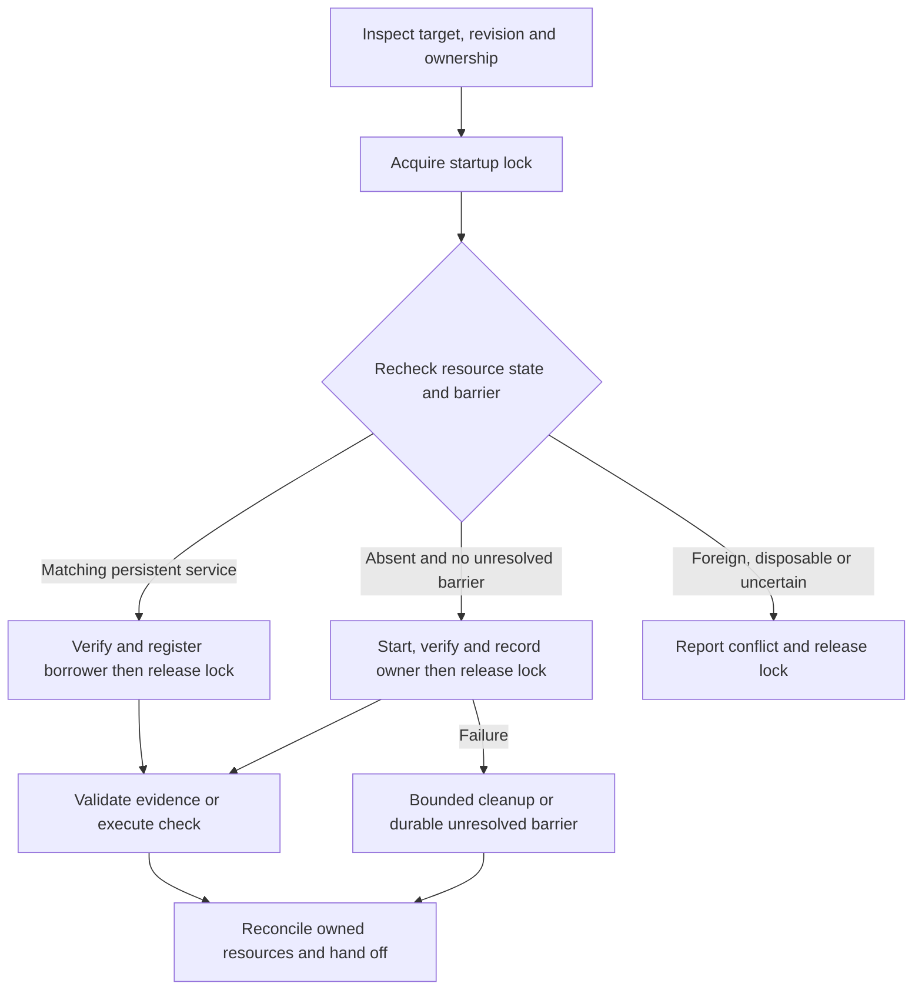

# SPEC-AGENT-EXECUTION — Bounded coding-agent execution and evidence reuse

- Status: Draft; documentation only, runtime behavior is not implemented.
- Date: 2026-11-09.
- Requirement / acceptance IDs: `AGENT-EXECUTION-Rnn` / `AGENT-EXECUTION-ACnn`.
- Decisions: [D-01–D-03](../decisions.md). Current authorization: [progress](../progress.md).
- Existing contracts: [core laws](../../references/base-kit.md), [agent pack](../../packs/PK-AGENT.md), [spec conventions](../../templates/docs/specs/README.md).

## 1. Outcome and provenance

An agent working on a repository can identify an existing implementation or running service, reuse valid verification evidence, and finish or stop an operation without leaving unidentified background work. Users can inspect what ran, which code was tested, what remains running, and why a command was repeated.

User-confirmed scope: on 2026-11-09 the user described layered code/duplicate instances, repeated tests without retained results, and Docker workloads left running while replacements start; they requested an English spec and Git commit after discussing remedies. These are reported symptoms, not independently reproduced runtime defects in this repository.

All mechanisms and numeric defaults below are **AI-proposed design choices**, not measured performance improvements or user-specified thresholds. Docker and prompt-cache semantics are sourced in section 11. No percentage reduction in tokens or runtime is promised.

Concrete example: a passing targeted test for snapshot A is recorded. With unchanged, fully identified inputs, another request to run that same check reuses its evidence when freshness policy allows. Editing an imported helper creates snapshot B and requires a new check. An already healthy development service is reused only after its environment and tested revision are verified.

In scope: an execution contract for agents and the smallest future repository-specific command safeguards. Out of scope: implementing those safeguards in this documentation batch, a universal runner/daemon, distributed scheduling, a new cache service, automatic singleton conversion, dependency replacement, and changing provider billing or prompt-cache settings.

Scope radar: **now** — requirements, design, planned checks and local documentation commit; **future authorization** — repository-specific enforcement and runnable fixtures; **excluded** — global cleanup, remote publication and a universal execution framework.

Concrete I/O snapshot (illustrative local record, **not** an implemented API): input `check=unit:parser, ENV-ID=worktree-a/local, snapshot=sha256:A, policy=input-bound`; first output `status=passed, executed=1, artifact=.agent-runs/run-a/parser.log`; unchanged repeat `status=reused, executed=0, original-run=run-a, snapshot=sha256:A`; imported-helper edit `snapshot=sha256:B` produces `status=execute-required`. A live check always produces `execute-required`, even with matching content.

## 2. Approach and alternatives

Use repository-native test/build caches, Compose project identity, existing process inspection, and existing task commands first. Add a small repository-local guard only for a concrete gap such as exclusive startup or terminating a timed-out child process tree. Do not introduce a new service or dependency by default.

Prompt-only rules were rejected as the sole enforcement: they cannot atomically prevent concurrent starts or terminate abandoned child processes. A universal execution framework was rejected because lifecycle and cache validity depend on the actual application, runner, OS, and external services. The chosen approach makes those boundaries explicit while preserving native tools.

The first implementation must inventory the target repository's commands, native caching, process control and Docker availability before choosing an adapter. This spec is usable without Docker: the same ownership and deadline rules apply to local servers, watchers and test workers.

## 3. Requirements

Each requirement's provenance is AI-proposed in response to the user-confirmed symptoms in section 1. Existing general rules remain authoritative; this spec supplies the execution-specific behavior rather than copying their full text.

- **AGENT-EXECUTION-R01 — Reuse code.** Before adding a wrapper, class, service or factory, locate the owner of the target behavior and inspect its callers. Reuse or modify it when it already covers the need. A new layer must name the missing responsibility and the observable behavior it enables. Multiple instances remain valid when their lifetimes or isolation require them.
- **AGENT-EXECUTION-R02 — Identify the environment.** Before starting or testing a service, resolve the canonical checkout/worktree, runtime endpoint or Docker context, service identity, configuration and code revision. A listening port or HTTP 200 alone is insufficient evidence of the correct application revision. Unknown identity prevents reuse as verification evidence.
- **AGENT-EXECUTION-R03 — Own resources.** Record whether each resource is created by this run, borrowed from another run, or explicitly persistent for the environment. Only persistent environment services may be borrowed; run-scoped test resources are exclusive to their owner. A persistent owner may stop or replace a service only after active borrowers finish or explicitly cancel their use. Ownership transfer must be explicit. Missing or stale records do not authorize killing a process or deleting a container.
- **AGENT-EXECUTION-R04 — Serialize startup.** Use exclusive ownership of an environment's startup/replacement operation. After acquiring it, recheck existing resources before creating anything. Use an existing native lock or an atomic OS mechanism; an unlocked check-then-write PID file is insufficient. A lost lock or uncertain owner requires inspection before recovery.
- **AGENT-EXECUTION-R05 — Bound operations.** Every long operation has an overall deadline and a maximum total attempt count, including the first attempt. Timeout/cancellation stops work created for that operation, including its child processes, and verifies the result within a finite cleanup grace period. Release startup ownership only after verified cleanup or a durable unresolved-resource barrier. Every subsequent startup checks that barrier under the lock and blocks conflicting work until reconciliation clears it.
- **AGENT-EXECUTION-R06 — Reuse evidence conservatively.** Reuse a successful check only when its complete relevant inputs match, its log/result remains available, and its freshness policy allows reuse. Unknown inputs mean a cache miss. Failed, timed-out, cancelled and partial results are diagnostic history, never proof of success.
- **AGENT-EXECUTION-R07 — Verify by impact.** During editing, run the smallest meaningful check for the changed behavior, expanding when dependencies or integration risks require it. Before handoff or commit, satisfy the repository's required checks for the final snapshot. Evidence reuse never bypasses an explicitly fresh-check requirement or turns an unexecuted scenario into a pass.
- **AGENT-EXECUTION-R08 — Stop unproductive repetition.** A repeated command needs a recorded reason: changed input, changed hypothesis, allowed transient retry, invalid evidence, or required freshness. An unchanged deterministic failure is not retried automatically. After two failed repair attempts for the same symptom without new evidence, record the eliminated hypotheses and obtain new diagnostic evidence before another repair.
- **AGENT-EXECUTION-R09 — Retain bounded evidence.** Save full logs locally and expose a bounded diagnostic excerpt with exit status, duration, tested snapshot and artifact path. Wait on an existing operation handle instead of launching another command. Poll within its deadline; an unchanged status/log does not justify a new diagnostic loop.
- **AGENT-EXECUTION-R10 — Reconcile and hand off.** Before reporting completion and after interruption/session compaction, reconcile saved records with live resources and workspace state. Report completed checks, reused evidence, unknowns, cleanup failures and intentionally retained services. Follow C17 for the single current-run handoff, C26 for independent review and C30 for authorized scope.

## 4. Identity, ownership and local records

`ENV-ID` identifies one canonical checkout/worktree plus its execution target and service configuration. `RUN-ID` identifies one agent task/batch. Keep them separate: a new chat does not automatically create a new environment, and two worktrees must not accidentally share a disposable stack.

The environment's Compose project name is stable across its runs. Parallel worktrees use distinct project names and published ports; fixed container names and explicitly external resources must also be checked for collisions. Project-name isolation alone does not isolate a shared database or external volume.

Use native resource metadata as the authority for live state. Record process identity with PID **and** start time, executable and working directory where available; record container identity with Docker context, container ID and Compose project/service labels. Recheck identity before termination to avoid PID reuse and stale records.

Minimum resource record: run and environment IDs, resource identity, endpoint, owner, created/borrowed/persistent lifetime, tested revision or unknown, and last observed state. Minimum operation record: command/arguments, working directory, start/deadline, attempt count, status/exit code, duration and log path. Minimum evidence record: check identity, input fingerprint and coverage, environment identity, freshness policy, result, completion time and artifact path.

These are field requirements, not a new service API. Reuse an existing artifact store or runner report. If absent, use ignored local files under `.agent-runs/`; keep only the current summary and relative artifact pointers in `docs/progress.md`. Do not commit machine PIDs, raw logs, secrets or machine-specific environment values. Retain evidence through handoff; delete referenced artifacts only after invalidating their evidence entries and confirming no active run uses them.

## 5. Resource lifecycle and Docker

Before startup, inspect the execution target, existing process/container, port, health and revision. Then choose one outcome:

1. Matching healthy persistent resource: borrow or reuse it under its existing owner; record active use before releasing startup ownership. A resource scoped to another run's tests is a conflict, even when healthy.
2. Matching resource still starting: wait on that startup within the existing deadline; do not duplicate it.
3. Owned unhealthy or obsolete resource: capture diagnostics, stop it, verify release, then replace within the same environment.
4. Foreign resource or unknown identity: report the conflict and continue only independent work; do not choose another port silently or terminate it.

For Compose, inspect the intended project before `up`; do not invent a new project name to escape a failure. Use `up --wait --wait-timeout <seconds>` when supported. Define application healthchecks: without them, a running container is not proof of readiness. Verify the running build using an existing version/build endpoint, image metadata plus build provenance, or another repository-defined revision check. A stale image or unknown source-to-image mapping cannot verify the new code.

The wait flag bounds readiness waiting; it is not a cleanup policy or an overall build/pull deadline. The operation supervisor must enforce the overall deadline and inspect containers left behind after failure. A borrowed stack must not be stopped merely because this run's command timed out.

Release the startup lock after readiness/revision checks and ownership recording, or after verified cleanup on failure. If cleanup fails, persist an unresolved barrier with exact resource identity before releasing the lock; failure to persist it prevents safe release/replacement and is reported as unresolved. Native live-resource inspection remains mandatory even when the record is absent. Successful test-only resources are cleaned up; an intentionally retained development service gets an explicit persistent owner and stop command. Persistent-service stop/replacement checks active borrower records under the same lock; an interrupted borrower requires live reconciliation before its claim can be cleared. On crash, the next run performs reconciliation rather than trusting a finally block to have executed.

Cleanup targets exact owned resource identities. Global prune, wildcard process kills, broad orphan removal and volume deletion are not default recovery steps. Stopping a disposable service does not authorize deleting persistent data. If the platform cannot prove ownership or terminate only the intended tree, stop replacement and report that limitation.

## 6. Evidence identity and invalidation

A reusable result identifies the command and arguments, working directory, test selection, current relevant source and test content, dependency lockfile and effective installed dependencies, runner/configuration versions, runtime/toolchain and relevant environment inputs. Include tracked and untracked inputs, additions, deletions and dirty changes. A commit SHA alone is not a snapshot of a dirty workspace.

Prefer the installed runner's documented input/dependency model. A custom fallback fingerprints all repository-owned build/test inputs and explicitly supplied external inputs; it does not infer affected tests from changed filenames alone. Exclude an output/cache directory only when it cannot affect that check. Consumed generated artifacts such as `dist/` must be fingerprinted, regenerated deterministically with validated producer provenance, or make reuse unavailable. If a build, script or generated input reads outside that known set, reuse is disabled until that dependency is represented. Snapshot changes during execution make the result unsuitable as evidence for the final workspace; run again against a stable snapshot or use an isolated snapshot.

Read effective dependencies from the runner/environment or perform the repository's deterministic dependency preparation; a matching lockfile does not prove that an already-installed dependency tree matches it. Environment identity is not just an environment filename. Do not persist secret values or unkeyed hashes of low-entropy secrets: use a safe existing configuration-version signal, or disable reuse when relevant secret changes cannot be identified safely.

Use three policies: `input-bound` for a deterministic check with complete inputs; `live` for a check that must execute against current external state; `unknown` when dependencies/freshness are not established. Only `input-bound` results may be skipped through evidence reuse. A live integration check may use native compilation caches but still executes its live assertions. Failures may retain artifacts to avoid repeating analysis, but remain failures.

Every skip reports the original completion time, snapshot and artifact, marked **reused**, not freshly executed. Missing artifacts, configuration changes, native cache invalidation, environment changes or unknown external state invalidate reuse. Do not write a new caching engine where a native runner already provides correct incremental execution.

## 7. Budgets, failure handling and output

Initial proposed defaults: service-readiness wait 120 seconds; each targeted check's overall deadline 300 seconds; automatic transient retry budget at most two total attempts; cleanup grace 10 seconds. The operation deadline includes all attempts and backoff; cleanup has a separate finite grace, making the wall-time ceiling the operation budget plus that grace. Known slower workloads declare their own finite budget before starting; do not silently extend a deadline after timeout. These values require calibration in the target repository and are not universal performance limits.

Retry only a classified transient failure such as a temporary transport interruption, within the same operation budget and only when repeating it is safe. A failed assertion, invalid configuration, port conflict, permission failure or unknown failure requires diagnosis. The two-repair rule in R08 counts edits/hypothesis attempts separately from transport retries; a changed command spelling alone does not reset either budget.

Keep full output in the local artifact. Default chat/tool excerpts are at most 80 lines and 32 KiB, with a pointer to the remainder and the actual process exit code. Extract a different bounded slice when needed. Do not use output truncation or a shell pipeline's last command status to hide a failing producer. Build/test commands use noninteractive, non-watch mode unless persistent mode was explicitly chosen and recorded.

Docker idle time consumes host resources; token waste arises from model turns, repeated tool calls and log ingestion. Track operation duration, attempts, resource disposition and evidence reuse counts. Token reporting is optional and uses provider telemetry when available; do not estimate savings from container uptime alone.

### Nonfunctional assessment

| Aspect | Proposed measurable condition / boundary | Verification or closure |
|---|---|---|
| Performance | Finite startup/check/cleanup budgets above; caching speedup unknown | AC06–AC08; calibrate actual runner before implementation |
| Security | No secret values/unkeyed secret hashes in evidence; no foreign termination or volume deletion | AC04/AC06/AC09; inspect local artifacts for fixture secret |
| Concurrency / limits | One startup owner per environment; at most two transient attempts | AC03/AC13/AC17 |
| Recovery / availability | Timeout produces verified cleanup or a durable replacement barrier | AC07/AC15; crash recovery AC17 |
| Observability | Actual exit status, snapshot, attempts, original evidence time and bounded excerpt | AC08/AC14; full artifact retained through handoff |
| i18n | N/A for runtime localization: this deliverable is an English execution contract | Future UI/CLI localization requires its own scope |
| Accessibility / UI states | N/A for a new interface: none is introduced; results are textual | Keep errors/status machine-readable in the existing command surface |

## 8. Acceptance criteria and visible test matrix

All scenarios below are **planned and unexecuted**; document validation does not satisfy runtime acceptance. IDs in the matrix have the prefix `AGENT-EXECUTION-`. Fixtures are future acceptance inputs, not existing scripts: `S` is a real loopback server with a start counter and revision response; `P` is a parent spawning a long-lived child; `T` is the target's deterministic runner with an invocation counter. Resolve their actual commands in the target repository before implementing the affected behavior. Docker checks remain unverified without Docker. Every row explicitly discloses mocking.

| ID / requirement | Given concrete input; When action | Then observable result | Level / dependencies | Status |
|---|---|---|---|---|
| **AGENT-EXECUTION-AC01** / R01 | Given helper `parse` and two callers; request equivalent parsing behavior | Identify owner/callers; reuse helper; any new layer names missing behavior in diff rationale | Inspection — **0 Mock** | [ ] |
| **AGENT-EXECUTION-AC02** / R02–R04 | Given persistent `S`, revision A, owner A; B verifies A then finishes | Start count stays 1; B's cleanup leaves S alive; borrower claim removed | Integration — **0 Mock**, real S and records | [ ] |
| **AGENT-EXECUTION-AC03** / R04 | Given empty environment; A/B start persistent S simultaneously | Exactly one start; second waits/reuses or conflicts; one live S | Integration — **0 Mock**, real concurrent processes/lock | [ ] |
| **AGENT-EXECUTION-AC04** / R02–R03 | Given foreign listener at target port, then stale PID with mismatching start time; start/recover each | Foreign process survives; identity conflict; zero silent alternate ports | Integration — **0 Mock**, real listener and stale record | [ ] |
| **AGENT-EXECUTION-AC05** / R02,R05 | Given worktree W1 project `agent-w1`; repeat start, then start W2 as `agent-w2` with distinct ports | W1 name unchanged; correct readiness/revisions; W2 leaves W1 unchanged | Integration — **0 Mock**, real Docker/local image | [ ] |
| **AGENT-EXECUTION-AC06** / R05 | Given owned container with always-failing healthcheck and volume sentinel; start with 2s readiness, 10s operation, 3s cleanup | Timeout; diagnostics; owned container stopped by 13s plus documented timer tolerance; volume sentinel intact; no conflicting replacement | Integration — **0 Mock**, real Docker/volume | [ ] |
| **AGENT-EXECUTION-AC07** / R05 | Given P/child each sleeping 60s; run with 2s operation and 3s cleanup | Both identities absent by 5s plus documented timer tolerance; lock released; cleanup failure instead leaves durable barrier | Integration — **0 Mock**, real process tree; failure branch covered by AC17 | [ ] |
| **AGENT-EXECUTION-AC08** / R06 | Given successful T for snapshot A, complete inputs, retained log; request twice unchanged | Invocation count 1; second marked reused with original snapshot/time/log | Integration — **0 Mock**, actual runner and filesystem | [ ] |
| **AGENT-EXECUTION-AC09** / R06 | Given AC08 baseline; separately edit helper, untracked fixture, deleted input, test, config, lockfile, installed dependency, toolchain, relevant environment version, consumed `dist/`; request each | Each change increments invocation count; dirty same-SHA edits invalidate; fixture secret is absent from evidence/logs | Integration — **0 Mock**, real inputs/environment; restore baseline per case | [ ] |
| **AGENT-EXECUTION-AC10** / R06–R07 | Given unchanged code and live service response changing A to B; separately remove log, mark coverage unknown, mutate workspace during T | Live assertions run each time; remaining cases cannot reuse old success for final snapshot | Integration — **0 Mock**, real loopback service/filesystem | [ ] |
| **AGENT-EXECUTION-AC11** / R07 | Given targeted pass, then final source edit; request handoff with explicitly fresh gate | Final snapshot covered; fresh gate executes; every other gate has valid evidence or explicit unverified status | Integration — **0 Mock**, actual repository gates | [ ] |
| **AGENT-EXECUTION-AC12** / R08 | Given T assertion exits 1; request check, then perform two failed repairs without new diagnostics | One automatic invocation for original failure; after second repair, record eliminated hypotheses and gather evidence before third repair | Integration + trace review — **0 Mock**, real failing test | [ ] |
| **AGENT-EXECUTION-AC13** / R05,R08 | Given retry-safe transport returning fail/success, then fail/fail/fail; run with 5s overall deadline | At most two total attempts including backoff within 5s; no third attempt | Integration — **Mock: transport responses only**; real timer/attempt counter | [ ] |
| **AGENT-EXECUTION-AC14** / R09 | Given process emitting 200 lines of 1024 ASCII bytes then exiting 7; report result | Excerpt <=80 lines and <=32KiB; full local log; recorded producer exit 7 | Integration — **0 Mock**, real output process | [ ] |
| **AGENT-EXECUTION-AC15** / R03,R10 | Given A killed before cleanup with S/records remaining; resume B after dirty edit | Reconcile live identities, expose retained/unresolved resources; no fresh pass from stale snapshot | Integration — **0 Mock**, real process interruption/files | [ ] |
| **AGENT-EXECUTION-AC16** / R02 | Given S returns HTTP 200 and revision A; target revision B | Revision mismatch blocks acceptance despite healthy HTTP response | Integration — **0 Mock**, real S | [ ] |
| **AGENT-EXECUTION-AC17** / R03–R05 | Given A's disposable S and B requesting reuse; then persistent S with active B when A requests stop; separately inject cleanup failure and restart supervisor | Disposable S cannot be borrowed; persistent stop waits/conflicts until B ends; durable barrier survives restart and blocks new start until verified reconciliation | Integration — **Mock: termination failure only**; real resources, lock, record persistence and restart | [ ] |

### Planned end-to-end verification

In a disposable checkout, run A/B concurrently against one environment (AC03), verify a persistent service's correct revision (AC02/AC16), execute T twice (AC08), change an imported input (AC09), and force a child timeout followed by supervisor restart (AC07/AC17). Final inspection must show one intended persistent service, no disposable owned leftovers, no false reused pass, and either verified cleanup or a durable conflict. Capture exact commands, resource identities, counts, exit codes, snapshots and artifact pointers. This scenario is unexecuted; implementation is blocked until fixture commands, OS controls and timer tolerance are defined.

## 9. Decision explanations and limits

**Decision: environment identity differs from run identity.** AI-proposed. A task owns work; an environment is where it runs. Input: checkout/target; action: inspect under startup ownership; output: reuse, start or conflict. Self-check steps: start persistent S as A, request it as B, finish B, then inspect start count and S's live identity; expect count 1 and S alive (AC02). Run concurrent starts in a fresh environment; expect one creator (AC03). Command binding is unknown until the target checkout is selected; block startup-guard implementation until its native lock and fixture commands are recorded. Native project names alone cannot isolate shared external resources.

**Decision: a recorded pass is conditional evidence.** AI-proposed. Input: prior record/current inputs; action: validate coverage and freshness; output: reuse or execute. Self-check steps: execute T twice unchanged, edit its imported helper and execute again, then change consumed generated output; expect counts 1, 2, 3 and original-time attribution only on reuse (AC08/AC09). Set a fixture secret and inspect artifacts; expect no secret or unkeyed secret hash. Unknown safe environment-version signal disables reuse. Actual T command/input model is unknown and blocks evidence-skip implementation until discovered. Whole-input fingerprints can over-invalidate; use the native dependency model when that cost becomes measurable.

**Decision: timeout includes resource reconciliation.** AI-proposed. Input: deadline/owned identities; action: cancel and inspect; output: cleaned or unresolved. Self-check steps: launch P with a 2s operation deadline/3s cleanup grace; inspect both identities after the bound; expect neither live. Inject termination failure, restart supervisor and request startup; expect preserved barrier and no replacement (AC07/AC17). Actual process-tree command and timer tolerance are unknown; block cleanup implementation until the host's controls are proven. A finally block cannot recover from every crash.

**Decision: numeric defaults are starting budgets.** AI-proposed. Input: readiness 120s/check 300s/cleanup 10s and at most two transient attempts; action: enforce elapsed time across retries; output: terminal status within operation plus cleanup budget. Self-check: use the short AC06/AC07/AC13 overrides to verify boundaries before measuring normal target workloads. Production calibration and timer tolerance remain unknown; block adoption of default budgets until representative workload measurements are recorded. Finite overrides remain mandatory; measured slow workloads may justify larger declared budgets.

## 10. Integration, rollout and rollback

This commit introduces only the design and session records. It changes no installed skill, agent, command, template, Docker resource or runtime setting. Spec readiness and a future task list do not grant implementation authority.

A future authorized batch first maps this contract to the target repository's existing tools, then implements only missing safeguards and runnable acceptance checks. Keep the entry-point `SKILL.md` small. Put reusable execution guidance in one reference or optional agent pack extension, linked by templates rather than copied into every skill. Add mechanical validation only for fields/links that actually exist after implementation; do not create a new core law or framework solely for this spec.

Apply identity/ownership/deadline handling before enabling evidence-based skips. Validate the input model with deliberate invalidation cases before permitting reuse. Unknown capability or input coverage defaults to running the check or reporting a resource conflict. Rollback disables skips and returns to native command execution; it preserves required verification, diagnostic artifacts and persistent data. Reconcile any outstanding owned resource before removing its execution record.

Open implementation inputs: the target application repository, its runner/cache semantics, OS process-tree controls, revision-proof mechanism, and calibrated budgets. They must be discovered and recorded before implementing the affected behavior. No runtime claim depends on guessing them in this documentation batch.

Independent review: recorded in [progress](../progress.md). Runtime acceptance remains unexecuted regardless of documentation review results.

## 11. Source boundaries

- [Docker Compose project names](https://docs.docker.com/compose/how-tos/project-name/) — project-level identity/isolation; consulted 2026-11-09. Isolation does not itself prove ownership or application revision.
- [Docker Compose up](https://docs.docker.com/reference/cli/docker/compose/up/) — reuse/recreation, detached operation and readiness-wait options; consulted 2026-11-09. Cleanup and overall operation deadlines are additional proposed safeguards.
- [OpenAI prompt caching](https://developers.openai.com/api/docs/guides/prompt-caching) — reuse of eligible matching prompt prefixes; consulted 2026-11-09. This is separate from build caches and test-result evidence and does not prevent repeated tool execution.
