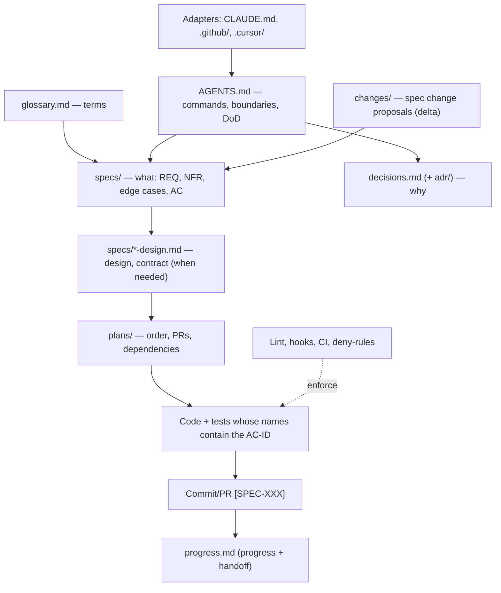

# Documentation principles for AI

Compiled from: an analysis of the `vmu-tools/dashboard` repo (internal repo); GitHub "How to write a great agents.md" (2,500 repos); Anthropic "Claude Code best practices", "Effective context engineering", "Skill authoring best practices"; GitHub Spec Kit; AWS Kiro; OpenSpec; BMAD; EARS; ADR/MADR; Diátaxis. Full sources in §8. Kit terms: [glossary.md](glossary.md).

> The numeric thresholds in this file (AGENTS.md ≤ ~150 lines, files read per session ≤ ~5 KB, hotfix ≤ 1 working day, spec > ~300 lines...) are **conventions of the kit**, with no measured source. The GitHub article (2,500 repos) advises writing a concise AGENTS.md but gives no number.

## Table of contents

1. The documentation model
2. The skill set by level (0 / 1 / 2)
3. Rules for writing specs
4. Writing style for agents
5. Which tool reads which file
6. Project skills vs downloaded skills
7. Lessons from real failures
8. Sources

---

## 1. The documentation model

| Layer | Question | File |
|---|---|---|
| Rules | Which commands, what is allowed/forbidden, when is it done | `AGENTS.md` (+ adapters, scoped rules) |
| Language | What does this word mean | `docs/glossary.md` |
| Decisions | Why | `docs/decisions.md`, `docs/adr/` |
| Requirements | What must be true | `docs/specs/` |
| Design | How it fits together, which options were rejected | `docs/specs/<nn>-<area>-design.md` |
| Changes | What changed in a spec that already ran | `docs/changes/` |
| Plan | What order, what in parallel | `docs/plans/` |
| Reference | Which variable, what each code means, what each version changed | `docs/reference/config.md`, `docs/reference/error-codes.md`, `docs/changelog/` |
| Memory | Where we are | `docs/progress.md` (including the new-session handoff section) |
| Enforcement | Machines block | lint, hooks, CI, settings deny |

**Traceability chain:** `D-xx → XXX-Rnn → XXX-ACnn → test name → commit [SPEC-XXX] → PR → progress`.

**Source-of-truth order:** the canonical definition is **source-of-truth order** (`C01`) in [base-kit.md §3](base-kit.md); it is not copied here.

---

## 2. The skill set by level

### Level 0 — Mandatory from day one

| # | Skill | Minimum required | Why |
|---|---|---|---|
| 0.1 | **Self-check commands, at the top of the file** | Full install/build/test/lint/dev with flags + a **run-1-test command** | The agent proves the code runs by itself; running 1 test is faster than the whole suite |
| 0.2 | **Context + concrete stack + level 1–2 map** | "NestJS 12 + Prisma + PostgreSQL 15", a 1–2 level directory tree with roles | "A React project" is too vague; a detailed tree goes stale fast |
| 0.3 | **Source-of-truth order + stop when ambiguous** | A priority table; "when ambiguous, stop, state what is unclear, propose options"; outside skills lose | Against fabricating requirements |
| 0.4 | **3-tier boundaries** | [x] Always do / (warning) Ask first / (blocked) Never | Without the "Always" tier the agent only knows prohibitions, not the right habits |
| 0.5 | **A verifiable DoD** | Commands must be green + ACs have tests + the status docs updated | "Done" must be evidence |
| 0.6 | **Code conventions by real example** | 1 short snippet or "do it like file `X`" | 1 example beats 3 paragraphs of description |
| 0.7 | **Git conventions** | Commit form, branch names, PR flow, things the agent must not do (merge, force push) | |
| 0.8 | **A complete spec template** | Goal, in/out scope, leveled REQs, NFR (a number or `N/A — reason`), edge cases, Given/When/Then ACs, open questions (write "None" if empty) | Whatever section is missing, the AI forgets that section |
| 0.9 | **Structured clarification** | An inline `[NEEDS CLARIFICATION: …]` marker; ask one question at a time with a proposed option; a spec is not `Ready` while markers remain | Turns "ambiguity" into something countable |
| 0.10 | **Append-only decisions with status** | A table of ID/date/decision/reason/**status (in effect / superseded by D-xx)**; a P-xx table of proposals that must be closed once done | The agent need not trace replacement chains |
| 0.11 | **Glossary** | `glossary.md`: term / definition / do not call it / name in code | Against mixing synonyms |
| 0.12 | **Put files where the tool reads them** | Per the §5 matrix; verify with `/context`, `/memory show` | A misplaced file does not exist |
| 0.13 | **Test the docs** | In a fresh session, give the agent 2–3 sample tasks; record skipped rules and questions the docs already answer | Untested docs are unfinished docs |
| 0.14 | **Cutting criterion** | Every line: "if removed, would the agent do something wrong?" If not, delete it. AGENTS.md ≤ ~150 lines | When long, the important rules get buried |
| 0.15 | **AI permissions by spec status** | A status × allowed / not allowed table in `docs/specs/README.md`; no coding a `Draft` spec; a hotfix updates the spec within ≤ 1 working day | A status only means something when tied to what the agent may do |
| 0.16 | **Type of change → file to edit** | A table in `docs/specs/README.md`, including a "stack change" row | Docs drift from code because nobody knows which file to edit |
| 0.17 | **Visual direction presentation** (`C28`) | Scope Radar (`(green) Do now / (yellow) Next batch / (red) Do not do`), option cards — Option Card (2–3 directions with a Mermaid diagram + ASCII wireframe/sample I/O) | Against "blind nodding" at long text tables, which makes the AI code away from the user's intent |
| 0.18 | **Visible test evidence** (`C29`) | A Transparent Test Matrix in the spec (`Concrete Input / Expected Output / Layer & Realism: 0 mocks or which mocks`) + a Test-Run Evidence Table after coding | Against "silent black-box tests" that only report pass while the developer does not know what the AI tested |

### Level 1 — Add when there is a signal

| Skill | Signal | Content |
|---|---|---|
| **Traceability + test layer for ACs** | > 3 specs, many people/agents | Test names contain the AC-ID; a layer column (unit/integration/contract/e2e/manual-reason); AC status `[ ]` / `[x]` / `[~]` (needs a real environment — state the reason + how to close it right in the spec) |
| **Design doc** | A spec needs > 2 PRs, touches schema/API/security | Components + flow, data model, contract, **rejected options**, risk + rollback, a REQ → component map, a cross-check against AGENTS.md principles |
| **Machine-readable contract + shared test data** | A public API, logic running on several runtimes (BE/FE) | OpenAPI/JSON Schema is the real source and the spec only links; one test-vector file used on every runtime; the error-code catalog in one place, with tests covering every translation |
| **Spec change (brownfield)** | A spec that is `Done` needs to change | `docs/changes/CHG-xx/proposal.md` with ADDED / MODIFIED (old → new) / REMOVED → deprecated; after merging, update the spec and move the proposal to the archive. Mostly-new parts → a child spec, never appended to a `Ready` spec |
| **As-built spec** | The repo has code but no spec yet | Status `As-built`; each REQ records evidence (file/test); suspicious behavior goes into open questions, not normalized; `[x]` only when an existing test proves it |
| **User scenarios + phases** | Several delivery batches | User stories with P1/P2/P3 priority, independently verifiable; REQs record the phase (`MUST (phase 2)`) so the agent does not build early |
| **Plan by milestone** | A spec > 2 PRs | A table of PR + branch + AC + **dependencies + parallel [P]**; the reason for the order; a checklist triggered by change type (schema/API/security); dependencies approved in batches; "minimum context" per PR (links to spec sections, files, ACs) |
| **Session memory** | Many sessions, switching agents | `progress.md` is the only place recording the current batch, the new-session handoff and the history (≤ 3 sentences per line); a rule for who moves a spec to `Done` |
| **Session context management** | Long sessions, the agent drifts | After writing the spec → a new session to code; fixing the same bug twice and still not green → record the rejected direction in the handoff, new session with a rewrite direction; overwrite the handoff at event milestones, no token counting; compaction instructions (RUN-ID, edited files, check command + open errors, waiting questions); after compaction re-read the batch block in `progress.md` (authority follows `progress.md`, drifted state is re-verified with the workspace/tests); survey with subagents |
| **Adapters + scoped rules** | > 1 tool, AGENTS.md > 150 lines | Adapters only point back to AGENTS.md; deep rules go to a subfolder `AGENTS.md` / `.github/instructions/*.instructions.md` (`applyTo`) / `.cursor/rules/*.mdc` (`globs`) |
| **PR template with conditional parts** | The AI opens PRs often | Parts filled only when entering an environment branch (tag, migration, rollback), machine-checked |
| **Upgrade / compatibility** | There are downstream projects | `docs/upgrade/<ver>.md` added per PR (schema / env / public API); `compatibility.md`; CI mandatory when the schema changes |
| **Cross-check against source documents** | The spec was built from a PRD/docx | A table mapping source sections → SPEC/REQ; a "deviations from the source" section |
| **Full ADR + current identifiers** | A decision has ≥ 2 significant options; identifiers changed many times | `docs/adr/D-xx-<slug>.md` (context, choice, result, consequences); a "current identifiers" table (org, scope, registry, domain) in one place |
| **Threat model** | Auth, authorization, personal data, payments | A table of assets / threats (STRIDE — Microsoft, Kohnfelder & Garg 1999) / mitigations / REQ-AC |
| **Fake/stub for ACs with external dependencies** | An AC needs an outside service | A fake that runs in CI; integration tests skip locally when the service is missing but **fail** on CI |
| **Docs security** | The repo has many contributors | AGENTS.md, skills, rules, hooks sit under CODEOWNERS; never copy untrusted content (issues, web) into docs; deny-rules block reading `.env` instead of only writing prose |

### Level 2 — Mature

| Skill | Content |
|---|---|
| **Machine enforcement** | A rule violated ≥ 2 times → lint/test/CI. The error message = **rule ID + how to fix** (`REPO-R11: upgrade the core with...`). Environment-dependent logic is written as pure functions for unit testing |
| **Hooks** | Prose is a recommendation, a hook is a guarantee: run lint after editing a file, block writes into released migration folders, re-inject the `progress.md` batch block right after compaction (Claude Code `SessionStart`/`compact`). Hooks run shell, so they must be reviewed |
| **Project skills** | A process repeated ≥ 2 times → `.agents/skills/` following the authoring rules (§4.3) |
| **Narrow-role subagents** | Personas live only in a dedicated agent file (`.claude/agents/`, `.github/agents/`) with limited tools; never put a persona in the root AGENTS.md |
| **Gotchas / knowledge base** | An error met → cause → how to avoid, placed in the related skill/guide; an error known but unfixed must have an issue |
| **Automatic docs checks** | AC-IDs have tests; no `[NEEDS CLARIFICATION]` in a `Ready` spec; specs have all sections; links are not broken; progress/plan are not older than the last `[SPEC]` commit; no REQ without an AC, no PR in the plan without a REQ |
| **Code generated from templates** | Scaffold/sample code is not hand-edited; CI diffs against the template |
| **Context pruning** | Archive old progress; files read per session ≤ ~5 KB |
| **Guide classification (Diátaxis)** | how-to / reference / explanation; never mix guides into specs |
| **Splitting a large spec** | A spec > ~300 lines: each PR in the plan has a "minimum context" so the agent does not load the whole spec |

**Life cycle of a rule:** prose → second violation → check/hook → shrink the prose to one line pointing to the check. Documentation should shrink over time.

---

## 3. Rules for writing specs

1. Separate *why* (decisions) / *what* (spec) / *how it fits* (design) / *order* (plan). A spec only writes the `D-xx` ID and never copies the reason.
2. Stable IDs: `SPEC-<AREA>`, `<AREA>-R01`, `<AREA>-AC01`. Never renumber; when dropping, write deprecated.
3. RFC 2119 levels (MUST / SHOULD / MAY) — **used only in specs**.
4. Write REQ sentences in EARS form where possible:
   - Always: `The system MUST ...`
   - Event: `When <event>, the system MUST ...`
   - State: `While <state>, the system MUST ...`
   - Error: `If <unwanted condition>, then the system MUST ...`
   - Optional: `Where <feature> is enabled, the system MUST ...`
5. ACs in *Given / When / Then* with concrete data; every REQ has ≥ 1 AC; there are ACs for errors and edge cases.
6. Numbers replace adjectives only when there is a requirement source or a measurement with conditions (**sources & knowledge limits**, `C31`); never invent p95/rate limits to fill the template. Unknown → an open question and a way to verify, not a commitment.
7. NFRs are always present: performance, security, limits, availability, observability, i18n, a11y, UI states. Not applicable → `N/A — reason`; a Draft that is unclear → `Unknown — P-xx + how to verify + the blocked part`.
8. "Out of scope" must not be empty.
9. One truth, one place; a machine-readable contract is the real source and the spec links to it.
10. When a decision changes a value in a REQ, fix that REQ **in the same PR**.
11. A conflict between two specs → record it in the open questions of **both**; never mark `[x]` an AC with an open conflict.
12. `[x]` needs green-test evidence; with CI, within the PR itself. A spec is `Done` only when every in-effect AC of the spec is `[x]`, not just the batch's ACs; `[~]` blocks `Done`. Deferring a requirement that needs a scope change is approved through change-spec.
13. A `Ready` spec is not appended with a large part; create a child spec or a change proposal.
14. Spec before code for new parts; work-breakdown content belongs in the plan, not in the spec.
15. A spec ends with an end-to-end check (command/scenario) so the agent can confirm by itself.
16. `Ready` is not permission to run (**per-batch execution authority**, `C30`): by default 1 spec / 1 task, record the batch in progress; finish the assigned scope, report evidence, then stop. A plan / ready-task list / HANDOFF does not assign more work by itself.
17. The user approves behavior/scope, and the AI is responsible for proving technical choices (`C31`). Writing both the expectations and the tests yourself does not prove the need is right: compare against agreed examples/contracts; another AI agreeing does not replace a source, a measurement or an expert.

### 3.1 Writing so non-experts can approve

1. **Meaning first, code after.** Templates copied into the target repo contain no `Cxx` rule codes; write the short meaning inside the sentence. Kit-internal files: on first use write ``**short name** (`Cxx`)``; a kit term is explained on first use or links to [glossary.md](glossary.md). Source: [Google — Abbreviations](https://developers.google.com/style/abbreviations).
2. **Four provenance labels, one claim per line:** `User decided` (date/quote) · `Verified` (exactly 1 openable pointer: `path:line` | URL + verbatim quote + read date | command + real result) · `AI proposed` (reason + consequence if wrong) · `Unknown` (how to verify + who + the blocked part). Never self-score %; a link is not enough, a quote must be present to compare. Sources: [Liu et al. 2023](https://arxiv.org/abs/2304.09848), [Anthropic — Reduce hallucinations](https://platform.claude.com/docs/en/test-and-evaluate/strengthen-guardrails/reduce-hallucinations).
3. **Technical Explanation & Decision Card** for every specialist mechanism/concept or technical decision the AI introduces into a spec/design/code: *What it is (plain words + a real example) · Why it is required here (what error happens without it) · How it runs step by step (Input → Process → Output) · Self-check in ≤ 5 minutes (command/action + expected result, pointing to the AC-ID) · Source & Cannot self-check*. **The explanation must not be cut so short that the reader cannot understand the knowledge the AI wrote**, but the user accepts correctness based on the real run result of the "Self-check" line (no blind approval just because the reasoning sounds smooth). Costly-to-check areas (security, payments, legal, personal data) are marked "needs expert: <role>"; an approval does not certify that part. Sources: [Bansal et al. 2021](https://arxiv.org/abs/2006.14779), [Vasconcelos et al. 2023](https://arxiv.org/abs/2212.06823).
4. **Distinguish the two directions when using a second AI (`C26` vs `C31`):** Forward direction — two AIs praising/agreeing on a number or algorithm **is not evidence of correctness** (`C31`). Reverse direction — using a clean session or a model from another family (`codex`, `claude`, `gemini` read-only / `spec-challenger` reading only `ARTIFACT + CONTRACT`) to **attack and catch errors, then hand them back to the writing AI to self-fix before presenting to the user** (`C26`) is the mandatory filter that breaks the blind spot of a single model.

---

## 4. Writing style for agents

### 4.1 General
- **Concrete, checkable:** "run `pnpm test -- path`", not "test thoroughly".
- **Affirmative first, prohibitions after:** "throw `PlatformException(code)`" is better than "do not throw a bare Error". Keep prohibitions for hard boundaries.
- **Moderate emphasis:** add IMPORTANT/caps only on lines the agent often skips; emphasizing every line means no line stands out.
- **Do not record fast-aging information:** line numbers, line-based anchors, patch versions. Point to `package.json`, `.nvmrc`.
- **Do not record what can be inferred from code** or a language's standard conventions; do not copy long API docs — link.
- **The right altitude:** avoid both rigid if-else and vague instructions; state the principle + one example.
- **Load just in time:** links/paths instead of stuffing content; `@import` loads verbatim so it saves no tokens.
- **Consistent terms** per the glossary.

### 4.2 AGENTS.md — recommended section order
Context + stack → **Commands** → Source of truth → 3-tier boundaries → Task process → DoD → Code conventions (example) → Git → Repo map. Cover all 6 areas: commands, tests, structure, style, git, boundaries.

### 4.3 Project skills
- `name`: lowercase, digits, hyphens, ≤ 64 characters.
- `description`: third person, state **what it does + when**, include keywords users often say, ≤ 1024 characters.
- Body < 500 lines; references 1 level deep; a file > 100 lines has a table of contents.
- Degree of freedom: high (heuristics) for review/design; low (scripts, hard checklists) for fragile operations: migration, deletion, release.
- A workflow with side effects (deploy, delete) turns off auto-activation if the tool supports it (`disable-model-invocation: true` in Claude Code).
- Name a global skill for general skills; do not copy it.

---

## 5. Which tool reads which file

> [!NOTE]
> This matrix changes fast. When applying it, re-check the tool's current documentation.

| Tool | Shared reads | Scoped rules | Notes |
|---|---|---|---|
| Antigravity | `AGENTS.md`, `GEMINI.md`, `.agents/rules/*.md` | `.agents/skills/` | Workspace > global > built-in |
| Claude Code | `CLAUDE.md` (root + subfolders when touching files) | `.claude/rules/`, `.claude/skills/`, `.claude/agents/` | **Does not read AGENTS.md by default** → `CLAUDE.md` contains `@AGENTS.md`; verify with `/context` |
| GitHub Copilot | `.github/copilot-instructions.md`, `AGENTS.md` (the nearest file wins) | `.github/instructions/*.instructions.md` with `applyTo: "glob"` | Files under `docs/` are not read |
| Codex | `AGENTS.md` / `AGENTS.override.md` from the root down to the working directory | nearer files are appended later | Truncated when the total > 32 KiB (`project_doc_max_bytes`) |
| Cursor | `AGENTS.md`, `.cursor/rules/*.mdc` | `globs`, `alwaysApply`, `description` | |
| Gemini CLI | `GEMINI.md` | subfolders | Set `context.fileName: ["AGENTS.md"]` instead of creating an adapter; verify with `/memory show` |

---

## 6. Project skills vs downloaded skills

| Criterion | In the project (`AGENTS.md`, `.agents/skills/`, rules) | Downloaded from GitHub (global) |
|---|---|---|
| Knowledge | The repo's *what / where* | General *how-to* (TDD, debug, review) |
| Scope | Workspace; the whole team shares one version via git | One machine; others do not have it |
| Version | Same commit as the code, reviewed via PR | Follows an outside repo, changes unexpectedly |
| Priority | Highest, wins on a name clash | Lower |
| Security | Written by the team, reviewed, CODEOWNERS | Supply-chain risk: scripts, dangerous commands, prompt injection |
| Context | AGENTS/rules always loaded; skills loaded by `description` | Every skill's description takes space; many skills trigger by mistake easily |
| Conflicts | One source | Overlaps, contradictions |

**Combine:** global for general skills, project for its own knowledge; a project skill names the global skill; AGENTS.md says "if an outside skill conflicts, follow this file"; one global skill per topic; read `SKILL.md` + every script before installing, pin a commit/tag.

---

## 7. Lessons from real failures (the dashboard repo)

> The anecdotes in §7 and §7.1 come from the author's internal repos, which outsiders cannot verify; use them as illustration, not as statistics.

| Failure | Preventive rule |
|---|---|
| A conflict between specs was recorded only in the plan/HANDOFF, and ACs were still marked `[x]` by "intent" | Record conflicts in the open questions of both specs; `[x]` is forbidden while a conflict is open |
| 18/19 specs dropped the open-questions section | A mandatory section, write "None" if empty; automatic check |
| "Mark `[x]` in the next PR" → ACs lag forever; conversely there are `[x]` ACs with no CI | `[x]` inside the PR itself with green CI |
| No spec was ever moved to `Done` | The DoD of the spec's last PR includes the status change |
| HANDOFF, plans, compatibility, P-xx tables go stale | Every status file has an update date; a check warns; finished P-xx must be closed |
| Identifiers (org/scope) replaced 4 times; a decision overrode a REQ while the REQ was not edited | A decision status column; a current-identifiers table; fix the REQ in the same PR |
| A spec copies decisions and reasons | A spec writes only the `D-xx` |
| A `Ready` spec was appended with 15 new REQs plus a work breakdown | A child spec / change proposal; put the breakdown in the plan |
| A knowledge file excluded by git and pointed to by no one; an adapter in the wrong folder; gotchas buried in a plan | No knowledge file is ignored; every docs file has a pointer to it; gotchas go into a guide/skill |
| A known bug marked "out of scope" with no issue | A known unfixed bug must have an issue/ID |
| A 23 KB journal in a file that must be read every session | progress kept separate, ≤ 3 sentences per line, archived periodically |
| ACs blocked by the GitHub Free plan, exhausted CI quota, a team that does not exist yet | Survey "external infrastructure conditions"; infrastructure-dependent ACs marked `[~]` from the start |
| A 170-line AGENTS.md loads RBAC rules when editing CSS | Scoped rules |

### 7.1 Errors repeated across projects (survey of 9 repos, 2026-10-20)

| Error | Seen in | Preventive rule |
|---|---|---|
| Docs describe something different from the code (key format, hash algorithm, directory tree, nonexistent files) | cdn ×3, BotAutoTask, notification-service | `As-built` with tests that prove it; dated gotchas; a "type of change → file to edit" table |
| Two files both claim to be the "source of truth" | notification (`SPECS.md` + `knowledge.md`), cdn (`SPECS.md` + `ARCHITECTURE.md`) | One truth one place; the survey greps "Single Source of Truth" |
| CI does not run tests, or runs the wrong stack after the stack changed | cdn, BotAutoTask, citad-*, notification (`Notification.slnx` deleted) | CI runs the DoD; a stack change is one change editing AGENTS + CI + conventions in the same PR |
| Commits do not follow the convention | cdn, khaosatvmu, citad-* | A violation ≥ 2 times → commitlint |
| The agent's personal allow-list (DB password, machine paths) is committed | khaosatvmu `.claude/settings.json` | The shared `settings.json` holds only deny + hooks; keep the allow-list in `settings.local.json` (ignored) |
| The sample env file name is inconsistent (`.env-example`) | citad-vmu-resources, vmu-deploy-tool | Always use `.env.example` |
| A status file tied to one tool | cdn `.devin/TASK.md` | `docs/progress.md` does not depend on a tool |
| The `migrate` command does nothing yet exits 0 | cdn | ACs for operational commands check the effect |
| A build file is committed but drifts from the source | BotAutoTask `dist/` | CI checks the artifact matches the source (PK-RELEASE) |

---

## 8. Sources

- GitHub — How to write a great agents.md: https://github.blog/ai-and-ml/github-copilot/how-to-write-a-great-agents-md-lessons-from-over-2500-repositories/
- Anthropic — Claude Code best practices: https://www.anthropic.com/engineering/claude-code-best-practices
- Anthropic — Effective context engineering: https://www.anthropic.com/engineering/effective-context-engineering-for-ai-agents
- Anthropic — Skill authoring best practices: https://docs.claude.com/en/docs/agents-and-tools/agent-skills/best-practices
- Claude Code memory / hooks / sub-agents: https://code.claude.com/docs/en/memory · https://code.claude.com/docs/en/hooks-guide · https://code.claude.com/docs/en/sub-agents
- GitHub Copilot repository instructions: https://docs.github.com/en/copilot/how-tos/configure-custom-instructions/add-repository-instructions
- Codex AGENTS.md: https://developers.openai.com/codex/guides/agents-md
- Cursor rules: https://docs.cursor.com/context/rules
- Gemini CLI GEMINI.md: https://geminicli.com/docs/cli/gemini-md
- agents.md: https://agents.md
- GitHub Spec Kit: https://github.com/github/spec-kit
- AWS Kiro specs: https://kiro.dev/docs/specs/
- OpenSpec: https://github.com/Fission-AI/OpenSpec
- BMAD Method: https://github.com/bmad-code-org/BMAD-METHOD
- EARS: https://alistairmavin.com/ears/
- ADR (Nygard): https://cognitect.com/blog/2011/11/15/documenting-architecture-decisions · MADR: https://adr.github.io/madr/
- Design docs at Google: https://www.industrialempathy.com/posts/design-docs-at-google/
- Diátaxis: https://diataxis.fr/
- Ubiquitous language: https://martinfowler.com/bliki/UbiquitousLanguage.html
- OWASP Threat Modeling: https://owasp.org/www-community/Threat_Modeling · WCAG 2.2: https://www.w3.org/TR/WCAG22/
- STRIDE (Microsoft; Kohnfelder & Garg 1999): https://learn.microsoft.com/en-us/azure/security/develop/threat-modeling-tool-threats
- Deep Module, Design It Twice — John Ousterhout, *A Philosophy of Software Design* (book)
- Tracer Bullet — Andrew Hunt & David Thomas, *The Pragmatic Programmer* (book)
- Seam — Michael Feathers, *Working Effectively with Legacy Code* (book)
- Expand–Contract (Parallel Change, Danilo Sato): https://martinfowler.com/bliki/ParallelChange.html

Sources for §3.1 (readability & claim provenance) — pages opened and compared verbatim on 2026-10-26:
- Google developer style — Abbreviations: https://developers.google.com/style/abbreviations — *"Spell out abbreviations on first reference, except for widely recognized ones"*
- Anthropic — Reduce hallucinations: https://platform.claude.com/docs/en/test-and-evaluate/strengthen-guardrails/reduce-hallucinations
- Liu, Zhang, Liang 2023 — Evaluating Verifiability in Generative Search Engines: https://arxiv.org/abs/2304.09848
- Bansal et al. 2021 — Does the Whole Exceed its Parts? (AI explanations and human–AI team performance): https://arxiv.org/abs/2006.14779
- Vasconcelos et al. 2023 — Explanations Can Reduce Overreliance on AI Systems During Decision-Making: https://arxiv.org/abs/2212.06823 — cost–benefit framing: an explanation reduces overreliance only when it makes checking the AI's prediction cheap enough
