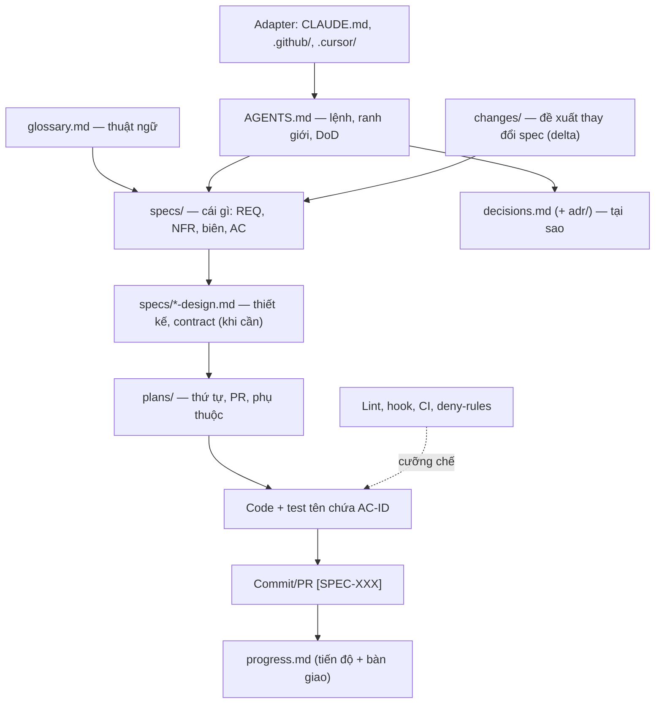

# Nguyên tắc tài liệu cho AI

Tổng hợp từ: phân tích repo `vmu-tools/dashboard` (repo nội bộ); GitHub "How to write a great agents.md" (2.500 repo); Anthropic "Claude Code best practices", "Effective context engineering", "Skill authoring best practices"; GitHub Spec Kit; AWS Kiro; OpenSpec; BMAD; EARS; ADR/MADR; Diátaxis. Nguồn đầy đủ ở §8. Thuật ngữ kit: [glossary.md](glossary.md).

> Các ngưỡng số trong file (AGENTS.md ≤ ~150 dòng, file đọc mỗi phiên ≤ ~5 KB, hotfix ≤ 1 ngày làm việc, spec > ~300 dòng…) là **quy ước của bộ kit**, không có nguồn đo lường. Bài GitHub (2.500 repo) khuyên viết AGENTS.md ngắn gọn nhưng không đưa con số.

## Mục lục

1. Mô hình tài liệu
2. Bộ kỹ năng theo mức (0 / 1 / 2)
3. Quy tắc viết spec
4. Phong cách viết cho agent
5. Công cụ nào đọc file nào
6. Skill trong dự án vs skill tải về
7. Bài học từ thất bại thực tế
8. Nguồn

---

## 1. Mô hình tài liệu

| Tầng | Câu hỏi | File |
|---|---|---|
| Luật | Lệnh nào, được/không được gì, khi nào xong | `AGENTS.md` (+ adapter, luật theo phạm vi) |
| Ngôn ngữ | Từ này nghĩa là gì | `docs/glossary.md` |
| Quyết định | Tại sao | `docs/decisions.md`, `docs/adr/` |
| Yêu cầu | Cái gì phải đúng | `docs/specs/` |
| Thiết kế | Ghép thế nào, phương án nào bị loại | `docs/specs/<nn>-<khu-vực>-design.md` |
| Thay đổi | Spec đã chạy đổi gì | `docs/changes/` |
| Kế hoạch | Thứ tự nào, song song gì | `docs/plans/` |
| Tra cứu | Biến nào, mã nào nghĩa gì, bản nào đổi gì | `docs/reference/config.md`, `docs/reference/error-codes.md`, `docs/changelog/` |
| Bộ nhớ | Đang ở đâu | `docs/progress.md` (gồm cả mục bàn giao phiên mới) |
| Cưỡng chế | Máy chặn | lint, hook, CI, settings deny |

**Chuỗi truy vết:** `D-xx → XXX-Rnn → XXX-ACnn → tên test → commit [SPEC-XXX] → PR → progress`.

**Thứ tự nguồn sự thật:** định nghĩa chuẩn ở **Thứ tự nguồn sự thật** (`C01`) trong [base-kit.md §3](base-kit.md); không chép lại ở đây.

---

## 2. Bộ kỹ năng theo mức

### Mức 0 — Bắt buộc từ ngày đầu

| # | Kỹ năng | Tối thiểu phải có | Vì sao |
|---|---|---|---|
| 0.1 | **Lệnh tự kiểm, đặt đầu file** | install/build/test/lint/dev đầy đủ flag + **lệnh chạy 1 test** | Agent tự chứng minh code chạy; chạy 1 test nhanh hơn cả bộ |
| 0.2 | **Bối cảnh + stack cụ thể + bản đồ cấp 1–2** | "NestJS 12 + Prisma + PostgreSQL 15", cây thư mục 1–2 cấp kèm vai trò | "React project" quá mơ hồ; cây chi tiết nhanh cũ |
| 0.3 | **Thứ tự nguồn sự thật + dừng khi mơ hồ** | Bảng ưu tiên; "mơ hồ thì dừng, nêu chỗ chưa rõ, đề xuất phương án"; skill ngoài thua | Chống bịa yêu cầu |
| 0.4 | **Ranh giới 3 tầng** | ✅ Luôn làm / ⚠️ Hỏi trước / 🚫 Không bao giờ | Thiếu tầng "Luôn" thì agent chỉ biết cấm, không biết thói quen đúng |
| 0.5 | **DoD kiểm chứng được** | Lệnh phải xanh + AC có test + tài liệu trạng thái cập nhật | "Xong" phải là bằng chứng |
| 0.6 | **Quy ước code bằng ví dụ thật** | 1 snippet ngắn hoặc "làm giống file `X`" | 1 ví dụ hơn 3 đoạn mô tả |
| 0.7 | **Quy ước git** | Dạng commit, tên nhánh, luồng PR, việc agent không được làm (merge, force push) | |
| 0.8 | **Spec template đủ mục** | Mục tiêu, phạm vi trong/ngoài, REQ có mức, NFR (số hoặc `N/A — lý do`), trường hợp biên, AC Cho/Khi/Thì, câu hỏi mở (ghi "Không có" nếu rỗng) | Thiếu mục nào thì AI quên mục đó |
| 0.9 | **Làm rõ có cấu trúc** | Marker `[CẦN LÀM RÕ: …]` trong dòng; hỏi từng câu kèm phương án đề xuất; spec không `Ready` khi còn marker | Biến "mơ hồ" thành việc đếm được |
| 0.10 | **Quyết định append-only có trạng thái** | Bảng ID/ngày/quyết định/lý do/**trạng thái (hiệu lực / bị thay bởi D-xx)**; bảng P-xx đề xuất, làm xong phải đóng | Agent không phải dò chuỗi thay thế |
| 0.11 | **Thuật ngữ** | `glossary.md`: thuật ngữ / định nghĩa / không gọi là / tên trong code | Chống dùng lẫn từ đồng nghĩa |
| 0.12 | **Đặt file đúng chỗ công cụ đọc** | Theo ma trận §5; kiểm bằng `/context`, `/memory show` | File đặt sai chỗ = không tồn tại |
| 0.13 | **Thử tài liệu** | Phiên mới, giao agent 2–3 task mẫu; ghi luật bị bỏ qua, câu hỏi đã có trong docs | Docs chưa thử là docs chưa xong |
| 0.14 | **Tiêu chí cắt** | Mỗi dòng: "bỏ đi agent có làm sai không?" Không thì xoá. AGENTS.md ≤ ~150 dòng | Dài thì luật quan trọng bị chìm |
| 0.15 | **Quyền AI theo trạng thái spec** | Bảng trạng thái × được làm / không được làm trong `docs/specs/README.md`; không code spec `Draft`; hotfix sửa spec trong ≤ 1 ngày làm việc | Trạng thái chỉ có nghĩa khi gắn với việc agent được phép làm |
| 0.16 | **Loại thay đổi → file phải sửa** | Bảng trong `docs/specs/README.md`, gồm dòng "đổi stack" | Docs lệch code vì không ai biết phải sửa file nào |
| 0.17 | **Trình bày định hướng bằng hình** (`C28`) | Scope Radar (`🟢 Làm ngay / 🟡 Đợt kế / 🔴 Không làm`), thẻ phương án — Option Card (2–3 hướng kèm sơ đồ Mermaid + ASCII wireframe/I-O mẫu) | Chống "gật đầu mù" trước bảng chữ dài khiến AI code lệch ý người dùng |
| 0.18 | **Bằng chứng test hiển thị** (`C29`) | Ma trận Test Minh bạch trong spec (`Input cụ thể / Output kỳ vọng / Tầng & Độ thật: 0 Mock hay Mock gì`) + Bảng Bằng chứng Chạy Test sau khi code | Chống "test hộp đen ngầm" chỉ báo pass mà lập trình viên không biết AI đã test cái gì |

### Mức 1 — Thêm khi có tín hiệu

| Kỹ năng | Tín hiệu | Nội dung |
|---|---|---|
| **Truy vết + tầng test cho AC** | > 3 spec, nhiều người/agent | Tên test chứa AC-ID; cột tầng (unit/integration/contract/e2e/thủ công-lý do); trạng thái AC `[ ]` / `[x]` / `[~]` (cần môi trường thật — ghi lý do + cách đóng ngay trong spec) |
| **Tài liệu thiết kế** | Spec cần > 2 PR, chạm schema/API/bảo mật | Thành phần + luồng, mô hình dữ liệu, contract, **phương án đã loại**, rủi ro + rollback, map REQ → thành phần, đối chiếu nguyên tắc AGENTS.md |
| **Contract máy đọc + dữ liệu kiểm thử dùng chung** | API công khai, logic chạy ở nhiều runtime (BE/FE) | OpenAPI/JSON Schema là nguồn thật, spec chỉ link; test vectors một file dùng ở mọi runtime; danh mục mã lỗi một chỗ, có test đủ bản dịch |
| **Thay đổi spec (brownfield)** | Spec đã `Done` cần đổi | `docs/changes/CHG-xx/proposal.md` với ADDED / MODIFIED (cũ→mới) / REMOVED→deprecated; merge xong cập nhật spec, chuyển proposal vào archive. Phần lớn mới → spec con, không nối vào spec `Ready` |
| **Spec hiện trạng (as-built)** | Repo có code nhưng chưa có spec | Trạng thái `As-built`; mỗi REQ ghi bằng chứng (file/test); hành vi đáng ngờ vào câu hỏi mở, không chuẩn hoá; `[x]` chỉ khi test hiện có chứng minh |
| **Kịch bản người dùng + giai đoạn** | Nhiều đợt giao hàng | US có ưu tiên P1/P2/P3, kiểm độc lập được; REQ ghi giai đoạn (`MUST (GĐ2)`) để agent không làm trước |
| **Plan theo milestone** | Spec > 2 PR | Bảng PR + nhánh + AC + **phụ thuộc + song song [P]**; lý do thứ tự; checklist kích hoạt theo loại thay đổi (schema/API/bảo mật); dependency duyệt theo lô; "ngữ cảnh tối thiểu" mỗi PR (link mục spec, file, AC) |
| **Bộ nhớ phiên** | Nhiều phiên, đổi agent | `progress.md` là nơi duy nhất ghi đợt hiện tại, bàn giao phiên mới và lịch sử (≤ 3 câu/dòng); quy tắc ai chuyển spec sang `Done` |
| **Quản lý context phiên** | Phiên dài, agent lạc hướng | Viết spec xong → phiên mới để code; sửa agent > 2 lần cùng lỗi → xoá context, viết lại prompt; chỉ dẫn compaction (giữ danh sách file đã sửa + lệnh test); khảo sát bằng subagent |
| **Adapter + luật theo phạm vi** | > 1 công cụ, AGENTS.md > 150 dòng | Adapter chỉ trỏ về AGENTS.md; luật chuyên sâu xuống `AGENTS.md` thư mục con / `.github/instructions/*.instructions.md` (`applyTo`) / `.cursor/rules/*.mdc` (`globs`) |
| **Mẫu PR có phần điều kiện** | AI mở PR thường xuyên | Phần chỉ điền khi vào nhánh môi trường (tag, migration, rollback), máy kiểm |
| **Nâng cấp / tương thích** | Có dự án phía dưới | `docs/upgrade/<ver>.md` bổ sung theo từng PR (schema / env / API công khai); `compatibility.md`; CI bắt buộc khi đổi schema |
| **Đối chiếu tài liệu nguồn** | Spec dựng từ PRD/docx | Bảng mục nguồn → SPEC/REQ; mục "phần lệch so với nguồn" |
| **ADR đầy đủ + định danh hiện hành** | Quyết định có ≥ 2 phương án đáng kể; định danh đổi nhiều lần | `docs/adr/D-xx-<slug>.md` (bối cảnh, lựa chọn, kết quả, hệ quả); bảng "định danh hiện hành" (org, scope, registry, domain) một chỗ |
| **Mô hình đe doạ** | Auth, phân quyền, dữ liệu cá nhân, thanh toán | Bảng tài sản / mối đe doạ (STRIDE — Microsoft, Kohnfelder & Garg 1999) / biện pháp / REQ-AC |
| **Fake/stub cho AC phụ thuộc ngoài** | AC cần dịch vụ bên ngoài | Fake chạy được trong CI; test tích hợp bỏ qua ở local khi thiếu dịch vụ nhưng **thất bại** trên CI |
| **Bảo mật tài liệu** | Repo có nhiều người đóng góp | AGENTS.md, skill, rule, hook nằm dưới CODEOWNERS; không chép nội dung chưa tin cậy (issue, web) vào docs; deny-rules chặn đọc `.env` thay vì chỉ viết văn xuôi |

### Mức 2 — Trưởng thành

| Kỹ năng | Nội dung |
|---|---|
| **Cưỡng chế bằng máy** | Luật vi phạm ≥ 2 lần → lint/test/CI. Thông báo lỗi = **ID luật + cách sửa** (`REPO-R11: nâng lõi bằng ...`). Logic phụ thuộc môi trường viết thành hàm thuần để unit test |
| **Hook** | Văn xuôi là khuyến nghị, hook là bảo đảm: chạy lint sau khi sửa file, chặn ghi vào thư mục migration đã phát hành. Hook chạy shell nên phải review |
| **Skill dự án** | Quy trình lặp ≥ 2 lần → `.agents/skills/` theo luật authoring (§4.3) |
| **Subagent vai trò hẹp** | Persona chỉ đặt trong file agent riêng (`.claude/agents/`, `.github/agents/`), giới hạn tool; không đặt persona ở AGENTS.md gốc |
| **Gotchas / knowledge base** | Lỗi đã gặp → nguyên nhân → cách tránh, đặt trong skill/guide liên quan; lỗi biết mà chưa sửa phải có issue |
| **Kiểm tài liệu tự động** | AC-ID có test; không còn `[CẦN LÀM RÕ]` ở spec `Ready`; spec có đủ mục; link không gãy; progress/plan không cũ hơn commit `[SPEC]` cuối; REQ không có AC, PR trong plan không có REQ |
| **Code sinh từ template** | Code scaffold/mẫu không sửa tay; CI so lệch với template |
| **Tỉa context** | Lưu trữ progress cũ; file đọc mỗi phiên ≤ ~5 KB |
| **Phân loại guide (Diátaxis)** | how-to / reference / explanation; không trộn hướng dẫn vào spec |
| **Chia nhỏ spec lớn** | Spec > ~300 dòng: mỗi PR trong plan có "ngữ cảnh tối thiểu" để agent không nạp cả spec |

**Vòng đời một luật:** văn xuôi → vi phạm lần 2 → check/hook → rút văn xuôi còn một dòng trỏ tới check. Tài liệu nên co lại theo thời gian.

---

## 3. Quy tắc viết spec

1. Tách *tại sao* (decisions) / *cái gì* (spec) / *ghép thế nào* (design) / *thứ tự* (plan). Spec chỉ ghi ID `D-xx`, không chép lý do.
2. ID ổn định: `SPEC-<KHU-VỰC>`, `<KHU-VỰC>-R01`, `<KHU-VỰC>-AC01`. Không đánh số lại; bỏ thì ghi deprecated.
3. Mức RFC 2119 (MUST / SHOULD / MAY) — **chỉ dùng trong spec**.
4. Câu REQ theo mẫu EARS khi được:
   - Luôn: `Hệ thống MUST …`
   - Sự kiện: `Khi <sự kiện>, hệ thống MUST …`
   - Trạng thái: `Trong khi <trạng thái>, hệ thống MUST …`
   - Lỗi: `Nếu <điều kiện không mong muốn>, thì hệ thống MUST …`
   - Tuỳ chọn: `Khi bật <tính năng>, hệ thống MUST …`
5. AC *Cho / Khi / Thì* với dữ liệu cụ thể; mỗi REQ ≥ 1 AC; có AC cho lỗi và biên.
6. Số thay tính từ khi có nguồn yêu cầu hoặc số đo kèm điều kiện (**Nguồn & giới hạn hiểu biết**, `C31`); không tự đặt p95/rate limit cho đủ mẫu. Chưa biết → câu hỏi mở và cách kiểm chứng, không là cam kết.
7. NFR luôn có mặt: hiệu năng, bảo mật, giới hạn, khả dụng, quan sát, i18n, a11y, trạng thái UI. Không áp dụng → `N/A — lý do`; Draft chưa rõ → `Chưa biết — P-xx + cách xác minh + phần bị chặn`.
8. "Ngoài phạm vi" không được rỗng.
9. Một sự thật một chỗ; contract máy đọc là nguồn thật, spec link tới.
10. Quyết định đổi giá trị trong REQ thì **cùng PR** sửa REQ đó.
11. Mâu thuẫn giữa hai spec → ghi vào câu hỏi mở của **cả hai**; không đánh `[x]` AC đang có mâu thuẫn mở.
12. `[x]` cần bằng chứng test xanh; có CI thì trong chính PR. Spec chỉ `Done` khi mọi AC còn hiệu lực của spec `[x]`, không chỉ AC của đợt; `[~]` chặn `Done`. Hoãn yêu cầu cần đổi phạm vi được duyệt qua change-spec.
13. Spec `Ready` không nối thêm phần lớn; tạo spec con hoặc change proposal.
14. Spec trước code cho phần mới; nội dung chia việc thuộc plan, không thuộc spec.
15. Spec kết thúc bằng cách kiểm end-to-end (lệnh/kịch bản) để agent tự xác nhận.
16. `Ready` không là quyền chạy (**Quyền thực thi theo đợt**, `C30`): mặc định 1 spec/1 task, ghi đợt trong progress; làm hết phạm vi đã giao, báo bằng chứng rồi dừng. Plan/danh sách task sẵn sàng/HANDOFF không tự giao thêm việc.
17. Người dùng duyệt hành vi/phạm vi, AI chịu trách nhiệm chứng minh lựa chọn kỹ thuật (`C31`). Tự viết cả kỳ vọng lẫn test chưa chứng minh nhu cầu đúng: đối chiếu ví dụ đã chốt/contract; AI khác đồng ý không thay nguồn, đo đạc hay chuyên gia.

### 3.1 Viết để người không chuyên duyệt được

1. **Nghĩa trước, mã sau.** Mẫu chép sang repo đích không chứa mã luật `Cxx`; viết nghĩa ngắn ngay trong câu. File nội bộ kit: lần đầu viết ``**tên ngắn** (`Cxx`)``; thuật ngữ kit lần đầu giải nghĩa hoặc link [glossary.md](glossary.md). Nguồn: [Google — Abbreviations](https://developers.google.com/style/abbreviations).
2. **Bốn nhãn nguồn gốc, một khẳng định một dòng:** `Người dùng chốt` (ngày/câu nói) · `Đã xác minh` (đúng 1 con trỏ mở được: `path:line` | URL + trích nguyên văn + ngày đọc | lệnh + kết quả thật) · `AI đề xuất` (lý do + hậu quả nếu sai) · `Chưa biết` (cách xác minh + ai + phần bị chặn). Không tự chấm %; có link chưa đủ, phải có câu trích để đối chiếu. Nguồn: [Liu et al. 2023](https://arxiv.org/abs/2304.09848), [Anthropic — Reduce hallucinations](https://platform.claude.com/docs/en/test-and-evaluate/strengthen-guardrails/reduce-hallucinations).
3. **Thẻ quyết định kỹ thuật** cho quyết định người dùng không tự thẩm định được: *Nói đơn giản · Nếu sai thì sao · Tự kiểm trong ≤ 5 phút (lệnh/thao tác + kết quả mong đợi, trỏ AC-ID) · Nguồn · Không tự kiểm được*. Người dùng duyệt kết quả quan sát được ở dòng "Tự kiểm", không duyệt lập luận. Vùng đắt kiểm (bảo mật, thanh toán, pháp lý, dữ liệu cá nhân) ghi "cần chuyên gia: <vai trò>"; lời duyệt không chứng nhận phần đó. Nguồn: [Bansal et al. 2021](https://arxiv.org/abs/2006.14779), [Vasconcelos et al. 2023](https://arxiv.org/abs/2212.06823).

---

## 4. Phong cách viết cho agent

### 4.1 Chung
- **Cụ thể, kiểm được:** "chạy `pnpm test -- path`", không phải "test kỹ".
- **Khẳng định trước, cấm sau:** "ném `PlatformException(code)`" tốt hơn "không ném Error trần". Giữ câu cấm cho ranh giới cứng.
- **Nhấn mạnh tiết chế:** chỉ thêm IMPORTANT/viết hoa cho dòng agent hay bỏ qua; nhấn mọi dòng = không dòng nào nổi.
- **Không ghi thông tin nhanh cũ:** số dòng, anchor theo dòng, phiên bản patch. Trỏ tới `package.json`, `.nvmrc`.
- **Không ghi điều suy ra được từ code** hay quy ước chuẩn của ngôn ngữ; không chép API docs dài — link.
- **Đúng độ cao:** tránh cả if-else cứng nhắc lẫn chỉ dẫn mơ hồ; nêu nguyên tắc + một ví dụ.
- **Nạp đúng lúc:** link/đường dẫn thay vì nhồi nội dung; `@import` nạp nguyên văn nên không tiết kiệm token.
- **Thuật ngữ nhất quán** theo glossary.

### 4.2 AGENTS.md — thứ tự mục khuyến nghị
Bối cảnh + stack → **Lệnh** → Nguồn sự thật → Ranh giới 3 tầng → Quy trình task → DoD → Quy ước code (ví dụ) → Git → Bản đồ repo. Phủ đủ 6 mảng: lệnh, test, cấu trúc, style, git, ranh giới.

### 4.3 Skill dự án
- `name`: chữ thường, số, gạch nối, ≤ 64 ký tự.
- `description`: ngôi thứ ba, nêu **làm gì + khi nào**, chứa từ khoá người dùng hay nói, ≤ 1024 ký tự.
- Body < 500 dòng; reference sâu 1 cấp; file > 100 dòng có mục lục.
- Độ tự do: cao (heuristic) cho review/thiết kế; thấp (script, checklist cứng) cho thao tác dễ vỡ: migration, xoá, phát hành.
- Workflow có tác dụng phụ (deploy, xoá) tắt tự kích hoạt nếu công cụ hỗ trợ (`disable-model-invocation: true` ở Claude Code).
- Gọi tên skill global cho kỹ năng chung, không chép lại.

---

## 5. Công cụ nào đọc file nào

> [!NOTE]
> Ma trận thay đổi nhanh. Khi áp dụng, kiểm lại tài liệu bản hiện hành của công cụ.

| Công cụ | Đọc chung | Luật theo phạm vi | Ghi chú |
|---|---|---|---|
| Antigravity | `AGENTS.md`, `GEMINI.md`, `.agents/rules/*.md` | `.agents/skills/` | Workspace > global > built-in |
| Claude Code | `CLAUDE.md` (gốc + thư mục con khi đụng file) | `.claude/rules/`, `.claude/skills/`, `.claude/agents/` | **Không đọc AGENTS.md mặc định** → `CLAUDE.md` có `@AGENTS.md`; kiểm `/context` |
| GitHub Copilot | `.github/copilot-instructions.md`, `AGENTS.md` (file gần nhất thắng) | `.github/instructions/*.instructions.md` với `applyTo: "glob"` | File trong `docs/` không được đọc |
| Codex | `AGENTS.md` / `AGENTS.override.md` từ gốc xuống thư mục làm việc | file gần hơn nối sau | Cắt khi tổng > 32 KiB (`project_doc_max_bytes`) |
| Cursor | `AGENTS.md`, `.cursor/rules/*.mdc` | `globs`, `alwaysApply`, `description` | |
| Gemini CLI | `GEMINI.md` | thư mục con | Đặt `context.fileName: ["AGENTS.md"]` thay vì tạo adapter; kiểm `/memory show` |

---

## 6. Skill trong dự án vs skill tải về

| Tiêu chí | Trong dự án (`AGENTS.md`, `.agents/skills/`, rules) | Tải từ GitHub (global) |
|---|---|---|
| Tri thức | *Cái gì / ở đâu* của repo | *Cách làm* chung (TDD, debug, review) |
| Phạm vi | Workspace; cả team cùng bản qua git | Một máy; người khác không có |
| Phiên bản | Cùng commit với code, review qua PR | Theo repo ngoài, đổi bất ngờ |
| Ưu tiên | Cao nhất, trùng tên thì thắng | Thấp hơn |
| Bảo mật | Team viết, review, CODEOWNERS | Rủi ro chuỗi cung ứng: script, lệnh nguy hiểm, prompt injection |
| Context | AGENTS/rules luôn nạp; skill nạp theo `description` | Mô tả mọi skill chiếm chỗ; nhiều skill dễ kích hoạt nhầm |
| Xung đột | Một nguồn | Chồng chéo, mâu thuẫn |

**Kết hợp:** global cho kỹ năng chung, dự án cho tri thức riêng; skill dự án gọi tên skill global; AGENTS.md ghi "skill ngoài mâu thuẫn thì theo file này"; mỗi chủ đề một skill global; đọc `SKILL.md` + mọi script trước khi cài, ghim commit/tag.

---

## 7. Bài học từ thất bại thực tế (repo dashboard)

> Giai thoại ở §7 và §7.1 lấy từ repo nội bộ của tác giả, người ngoài không kiểm được; dùng minh hoạ, không phải số liệu thống kê.

| Thất bại | Quy tắc phòng tránh |
|---|---|
| Mâu thuẫn giữa spec chỉ ghi trong plan/HANDOFF, AC vẫn bị `[x]` theo "ý" | Mâu thuẫn ghi vào câu hỏi mở của cả hai spec; cấm `[x]` khi còn mâu thuẫn mở |
| 18/19 spec bỏ mục câu hỏi mở | Mục bắt buộc, ghi "Không có" nếu rỗng; check tự động |
| "Đánh `[x]` ở PR kế tiếp" → AC trễ mãi; ngược lại có AC `[x]` khi chưa có CI | `[x]` trong chính PR có CI xanh |
| Không spec nào chuyển `Done` | DoD của PR cuối spec gồm chuyển trạng thái |
| HANDOFF, plan, compatibility, bảng P-xx cũ | Mỗi file trạng thái có ngày cập nhật; check cảnh báo; P-xx làm xong phải đóng |
| Định danh (org/scope) bị thay 4 lần; quyết định ghi đè REQ mà REQ không sửa | Cột trạng thái quyết định; bảng định danh hiện hành; sửa REQ cùng PR |
| Spec chép lại quyết định và lý do | Spec chỉ ghi `D-xx` |
| Spec `Ready` bị nối 15 REQ mới kèm phần chia việc | Spec con / change proposal; chia việc vào plan |
| File tri thức bị git loại trừ, không ai trỏ tới; adapter đặt sai thư mục; gotchas chôn trong plan | Không file tri thức bị ignore; mọi file docs có nơi trỏ tới; gotchas vào guide/skill |
| Lỗi biết mà ghi "ngoài phạm vi", không issue | Lỗi biết mà chưa sửa phải có issue/ID |
| Nhật ký 23 KB trong file phải đọc mỗi phiên | progress tách riêng, ≤ 3 câu/dòng, lưu trữ định kỳ |
| AC chặn vì gói GitHub Free, hết hạn mức CI, team chưa tồn tại | Khảo sát "điều kiện hạ tầng bên ngoài"; AC phụ thuộc hạ tầng gắn `[~]` từ đầu |
| AGENTS.md 170 dòng nạp luật RBAC khi sửa CSS | Luật theo phạm vi |

### 7.1 Lỗi lặp lại giữa các dự án (khảo sát 9 repo, 2026-10-20)

| Lỗi | Gặp ở | Quy tắc phòng tránh |
|---|---|---|
| Docs mô tả khác code (format key, thuật toán hash, cây thư mục, file không tồn tại) | cdn ×3, BotAutoTask, notification-service | `As-built` kèm test chứng minh; gotcha có ngày kiểm; bảng "loại thay đổi → file phải sửa" |
| Hai file cùng nhận là "nguồn sự thật" | notification (`SPECS.md` + `knowledge.md`), cdn (`SPECS.md` + `ARCHITECTURE.md`) | Một sự thật một chỗ; khảo sát grep "Single Source of Truth" |
| CI không chạy test, hoặc chạy sai stack sau khi đổi stack | cdn, BotAutoTask, citad-*, notification (`Notification.slnx` đã xoá) | CI chạy DoD; đổi stack là một change sửa AGENTS + CI + quy ước cùng PR |
| Commit không theo quy ước | cdn, khaosatvmu, citad-* | Vi phạm ≥ 2 lần → commitlint |
| Allow-list cá nhân của agent (mật khẩu DB, đường dẫn máy) bị commit | khaosatvmu `.claude/settings.json` | `settings.json` chung chỉ chứa deny + hook; allow-list để ở `settings.local.json` (ignore) |
| Tên file env mẫu không thống nhất (`.env-example`) | citad-vmu-resources, vmu-deploy-tool | Luôn dùng `.env.example` |
| File trạng thái gắn chặt một công cụ | cdn `.devin/TASK.md` | `docs/progress.md` không phụ thuộc công cụ |
| Lệnh `migrate` không làm gì mà vẫn exit 0 | cdn | AC của lệnh vận hành kiểm tác dụng |
| File build được commit nhưng lệch với nguồn | BotAutoTask `dist/` | CI kiểm artifact khớp nguồn (PK-RELEASE) |

---

## 8. Nguồn

- GitHub — How to write a great agents.md: https://github.blog/ai-and-ml/github-copilot/how-to-write-a-great-agents-md-lessons-from-over-2500-repositories/
- Anthropic — Claude Code best practices: https://www.anthropic.com/engineering/claude-code-best-practices
- Anthropic — Effective context engineering: https://www.anthropic.com/engineering/effective-context-engineering-for-ai-agents
- Anthropic — Skill authoring best practices: https://docs.claude.com/en/docs/agents-and-tools/agent-skills/best-practices
- Claude Code memory / hooks / sub-agents: https://code.claude.com/docs/en/memory · https://code.claude.com/docs/en/hooks-guide · https://code.claude.com/docs/en/sub-agents
- GitHub Copilot repository instructions: https://docs.github.com/en/copilot/how-tos/configure-custom-instructions/add-repository-instructions
- Codex AGENTS.md: https://developers.openai.com/codex/guides/agents-md
- Cursor rules: https://docs.cursor.com/context/rules
- Gemini CLI GEMINI.md: https://geminicli.com/docs/cli/gemini-md
- agents.md: https://agents.md
- GitHub Spec Kit: https://github.com/github/spec-kit
- AWS Kiro specs: https://kiro.dev/docs/specs/
- OpenSpec: https://github.com/Fission-AI/OpenSpec
- BMAD Method: https://github.com/bmad-code-org/BMAD-METHOD
- EARS: https://alistairmavin.com/ears/
- ADR (Nygard): https://cognitect.com/blog/2011/11/15/documenting-architecture-decisions · MADR: https://adr.github.io/madr/
- Design docs at Google: https://www.industrialempathy.com/posts/design-docs-at-google/
- Diátaxis: https://diataxis.fr/
- Ubiquitous language: https://martinfowler.com/bliki/UbiquitousLanguage.html
- OWASP Threat Modeling: https://owasp.org/www-community/Threat_Modeling · WCAG 2.2: https://www.w3.org/TR/WCAG22/
- STRIDE (Microsoft; Kohnfelder & Garg 1999): https://learn.microsoft.com/en-us/azure/security/develop/threat-modeling-tool-threats
- Deep Module, Design It Twice — John Ousterhout, *A Philosophy of Software Design* (sách)
- Tracer Bullet — Andrew Hunt & David Thomas, *The Pragmatic Programmer* (sách)
- Seam — Michael Feathers, *Working Effectively with Legacy Code* (sách)
- Expand–Contract (Parallel Change, Danilo Sato): https://martinfowler.com/bliki/ParallelChange.html

Nguồn cho §3.1 (đọc dễ & nguồn gốc khẳng định) — đã mở trang và đối chiếu nguyên văn ngày 2026-10-26:
- Google developer style — Abbreviations: https://developers.google.com/style/abbreviations — *"Spell out abbreviations on first reference, except for widely recognized ones"*
- Anthropic — Reduce hallucinations: https://platform.claude.com/docs/en/test-and-evaluate/strengthen-guardrails/reduce-hallucinations
- Liu, Zhang, Liang 2023 — Evaluating Verifiability in Generative Search Engines: https://arxiv.org/abs/2304.09848
- Bansal et al. 2021 — Does the Whole Exceed its Parts? (giải thích của AI và hiệu quả nhóm người–AI): https://arxiv.org/abs/2006.14779
- Vasconcelos et al. 2023 — Explanations Can Reduce Overreliance on AI Systems During Decision-Making: https://arxiv.org/abs/2212.06823 — khung chi phí–lợi ích: lời giải thích chỉ giảm phụ thuộc quá mức khi nó làm việc kiểm tra dự đoán của AI đủ rẻ
