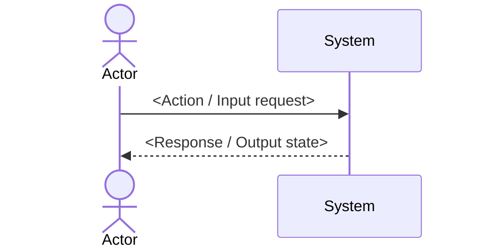

# SPEC-XXX — Title

| Attribute | Value |
|---|---|
| Status | Draft <!-- Draft  Ready  In progress  Done; or As-built (spec of existing code) --> |
| Phase | 1 |
| Depends on | SPEC-… |
| Related decisions | D-… |
| Design | <!-- link *-design.md if any --> |

## Short Read for Behavior Approval

- **After the change, who can do what:** <one observable outcome>.
- **Self-check example:** <input/action  expected result, pointing to AC-ID>. Prefer user-provided examples: if the AI writes both expectation and test, green only proves code matches the AI's expectation.
- **Not done in first pass:** <adjacent behaviors excluded>.
- **Unknowns & consequences:** <unproven items, impact, who/how to verify; or None>.
- **User-decided part:** <behavior, scope, trade-offs>; technical details see sources below.
- **Knowledge & technical decision explanation:** <see explanation card in §9; explains the mechanism clearly with real project data so readers understand and have a "Self-check" line runnable in ≤ 5 min>.
- **Independent challenge report before presenting:** <Mode run: `Cross-model (<authoring model>  <challenging CLI model>)` or `Clean same-model session (spec-challenger — reason other model unavailable)` · Self-fixed: `...` · Not fixed / Needs user decision: `...` (hiding findings forbidden)>.
- **Run authority:** `Ready` does not grant code authority; assigned batches live in `../progress.md`.

## 1. Goal

<Problem, for whom, how success is measured.>

## 2. Scope

**In scope:**
**Out of scope:** <!-- must not be empty -->

## 3. Interaction flow, I/O examples & user scenarios

- **US1 (P1)** — As a <role>, I want <…> so that <…>. Independently verifiable: <…>. AC: XXX-AC01..AC03.

### Main interaction flow (Mermaid diagram)



### Concrete I/O examples (Concrete I/O Snapshot)

<!-- Draw ASCII UI wireframe (if screens), CLI command + output samples, or real JSON request/response so developers immediately see the feature's shape. -->
```text
+-------------------------------------------------------------------+
| [Screen title / CLI command / POST endpoint /api/v1/...]          |
| Input:  {... }                                                   |
| Output: {... } (UI state / DB changes)                            |
+-------------------------------------------------------------------+
```

## 4. Requirements

| ID | Level | Requirement | Origin |
|---|---|---|---|
| XXX-R01 | MUST | When <event>, the system MUST <…>. | User decided — <date/quote or §11 Clarifications> |
| XXX-R02 | MUST | If <error condition>, then the system MUST <…>. | Verified — `<path:line>` · or AI proposed — <reason; if wrong then…> |

**Origin labels** (sources & knowledge limits; one claim per line, no self-scored %): `User decided` — with date/quote or Clarifications section · `Verified` — with exactly 1 openable pointer: `path:line` | URL + verbatim quote + read date | command + real result · `AI proposed` — 1-line reason + consequence if wrong · `Unknown` — how to verify + who + blocked part.

<!-- EARS patterns: Always / When <event> / While <state> / If <error> then / When <feature> enabled. Unclear spots: [NEEDS CLARIFICATION: …] -->

### Inherited from Domain Pack (`PK-*`) <!-- delete this subsection if spec doesn't inherit a pack -->

| Project REQ | Inherited from Pack | `{…}` params filled / Overrides |
|---|---|---|
| XXX-R03 | `PK-API-R01` | `{error-code-doc}` = `docs/reference/error-codes.md` |

## 5. Non-functional requirements

| Aspect | Checkable condition / `N/A — reason` / `Unknown — P-xx` | Origin label & how to verify |
|---|---|---|
| Performance | | |
| Security (sensitive data, permissions, no logging) | | |
| Limits / rate limit | | |
| Availability / recovery | | |
| Observability (logs, metrics, audit) | | |
| i18n | | |
| a11y | | |
| UI states (loading / empty / error / forbidden) | | |

<!-- Don't turn example numbers into commitments. Measurements must include load/environment/date; standards or API docs don't prove the product complies. Drafts record Unknown with blocked parts and how to close. -->

## 6. Edge cases

- <edge question>  XXX-AC0n | out of scope

## 7. Acceptance conditions & test matrix

| Status | Meaning |
|---|---|
| `[]` | not met |
| `[x]` | green test with command/result evidence; with CI, in the PR that makes that AC (test evidence table) |
| `[~]` | unverified — record reason, owner/how to close; blocks `Done` |

### Test matrix — approve before coding (Visible Test Matrix)

| AC ID | Scenario (`Given / When / Then`) | Concrete input | Observable expectation (output & side effects) | Tier & fidelity (`0 Mock` or which mocks) | Status |
|---|---|---|---|---|---|
| **XXX-AC01** | Main branch: <…> | `<payload / params / action>` | `<HTTP 200 + body / DB record / DOM state>` | `integration` — **0 Mock** (real DB) | `[]` |
| **XXX-AC02** | Error/edge branch: <…> | `<bad input / over threshold>` | `<HTTP 4xx + errorCode / no DB write>` | `unit` / `integration` — **Mock:** `<state clearly or 0 Mock>` | `[]` |

## 8. End-to-end verification

<Command or scenario for the agent to confirm the whole spec works.>

## 9. Design notes

<Architecture constraints only. Design details live in the design file. No task splitting here — that belongs to the plan.>

### Knowledge & technical decision explanation (Technical Explanation Card)

<!-- At least 1 card must be shown explicitly (NOT hidden in comments, NOT "none / standard CRUD" to dodge it) for the mechanism, data constraint, NFR threshold, or technical decision of this spec. Must explain with the project's real entities/flows (no generic glossary examples); readers understand the essence and verify correctness via the "Self-check" step. -->

**Concept / Decision 1:** `<Mechanism / constraint / technical decision name in this spec>` · Label: `<User decided | Verified | AI proposed | Unknown>`
- **What it is (plain language + real project example):** <Explain in everyday words with 1 example using this project's actual table/API/screen names; never just English jargon or copied sample examples>
- **Why it's required here (what breaks if removed?):** <Observable failure scenario on this project's data/users if this mechanism is skipped>
- **How it runs in this project (Input  Processing  Output):** <2–3 short steps: what data enters, what transforms, what's returned>
- **Self-check in ≤ 5 min:** <Command or action + expected result, pointing to `AC-ID` so users verify themselves>
- **Reference source & limits that can't be self-checked:** <Openable pointer + verbatim quote; security/payment/legal/personal-data areas  write "needs expert: <role>"; or "None">

## 10. Operations guide <!-- optional; for operators, not REQ -->

## 11. Clarifications

<!-- ### Session YYYY-MM-DD
- Q: …  A: … (recorded into R0n / D-xx) -->

## 12. Open questions

<!-- Write "None" if empty. Conflicts with other specs: record in both specs. -->

| Unknown / proposal | Sources checked | Impact / blocked AC | How to verify & owner |
|---|---|---|---|
| <P-xx or question> | <evidence or None> | <dependent part; doesn't block independent parts> | <allowed research/experiment/expert> |
