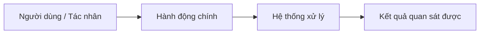

# Đề xuất thiết kế docs cho AI — <tên dự án>

> Trạng thái: **Chờ review (Cổng 1)**. Chưa tạo file nào trong repo.

## Bản đọc ngắn

- **Kết quả đầu tiên:** <ai làm gì, thấy kết quả nào>.
- **Ví dụ nghiệm thu:** <thao tác → kết quả; trỏ AC dự kiến>.
- **Giới hạn lần đầu:** <một spec/lát cắt; phần sau giữ ở bản đồ, chưa viết chi tiết>.
- **Điều chưa biết:** <ảnh hưởng, cách xác minh, người phụ trách>.
- **Bạn duyệt:** <hành vi/phạm vi/đánh đổi>; AI chịu trách nhiệm kiểm chứng kỹ thuật; mọi khái niệm hoặc quyết định kỹ thuật AI đưa vào sẽ kèm **Thẻ giải thích kỹ thuật** (giải thích rõ bản chất + lý do + luồng chạy để bạn hiểu, kèm dòng "Tự kiểm trong ≤ 5 phút"). Duyệt bản đồ chưa cấp quyền chạy các spec.

## 1. Hiện trạng

| Hạng mục | Phát hiện | Bằng chứng |
|---|---|---|
| Stack (major version) | | `package.json` |
| Lệnh build/test/lint/dev, chạy 1 test | | |
| Greenfield / brownfield | | |
| Tài liệu sẵn có + vị trí đúng/sai công cụ đọc | | |
| File mồ côi / bị ignore / cũ / mâu thuẫn | | |
| Tài liệu nguồn bên ngoài (PRD, docx) | | |
| Cưỡng chế & sàn chất lượng hiện tại (chỉ được siết, không hạ âm thầm) | | |
| Quy ước git thực tế | | `git log` |
| Vùng rủi ro & tín hiệu bật Pack (`PK-*`) | | |
| Điều kiện hạ tầng bên ngoài có thể chặn AC | | |
| Công cụ AI team dùng | | |

## 2. Mức đề xuất

- Base: writing-spec-for-ai v1.3.0 · Profile: <S | M | L> — gợi ý S < ~30 file, M ~30–200, L > 200; số file chỉ là gợi ý, tín hiệu (số người, CI, vùng rủi ro, số spec) quyết định cuối cùng. Xem `profiles.md` về file tối thiểu.
- Pack: <PK-… — tín hiệu: …> — xem `packs/PK-….md` về tín hiệu bật và REQ.
- Mức 0: toàn bộ luật Core của base.
- Mức 1: <thành phần> — tín hiệu: <…>
- Mức 2: <thành phần> — tín hiệu: <…>

## 3. Cây file đề xuất

```
AGENTS.md
CONSTRAINTS.md                    # Profile L; Profile M chỉ khi có tín hiệu: sàn chất lượng chỉ được siết
CLAUDE.md                         # adapter
.github/copilot-instructions.md   # adapter (nếu dùng Copilot)
docs/glossary.md
docs/decisions.md
docs/reference/config.md
docs/reference/error-codes.md
docs/specs/README.md
docs/specs/_template.md
docs/specs/00-<khu-vực>.md        # Draft / As-built
docs/progress.md
docs/plans/                       # mức 1
docs/changes/                     # mức 1, brownfield
.agents/skills/<tên>/SKILL.md     # mức 2
```

| File | Mục đích | Nội dung chính | Tạo / sửa / di chuyển / xoá |
|---|---|---|---|

## 4. Nội dung dự kiến của AGENTS.md & CONSTRAINTS.md

- **Lệnh (gồm lệnh chạy 1 test):**
- **Con trỏ có điều kiện ("Khi chạm X → đọc Y"):**
- ✅ **Luôn (đánh dấu `ceiling:` khi cố ý chọn giải pháp đơn giản có giới hạn):**
- ⚠️ **Hỏi trước:**
- 🚫 **Không bao giờ (không hạ chuẩn âm thầm):**
- **DoD & Sàn `CONSTRAINTS.md`:**
- **File mẫu để bắt chước:**
- **Luật chuyển xuống phạm vi:** <thư mục → luật>

## 5. Định hướng bằng hình, bản đồ năng lực & spec dự kiến

### 5.1 Scope Radar (bảng phạm vi: 🟢 Làm ngay / 🟡 Đợt kế / 🔴 Không làm)

| 🟢 Làm ngay (MVP — GĐ 1) | 🟡 Đợt kế tiếp (Phase 2) | 🔴 Không làm (Out of Scope) |
|---|---|---|
| - <Hành vi cốt lõi 1> | - <Mở rộng sang GĐ 2> | - <Thứ loại bỏ rõ ràng để AI không làm thừa> |

### 5.2 Luồng tương tác tổng thể & phương án trực quan



<!-- Nếu định hướng sản phẩm/kiến trúc còn mở (≥ 2 hướng), trình bày 2–3 Phương án trực quan kèm Snapshot I/O (ASCII wireframe / CLI / JSON mẫu) để người dùng chọn trước khi viết spec. Xoá khối Option Cards nếu chỉ có 1 hướng duy nhất. -->
- **Phương án A (Khuyến nghị):** <Mô tả 1 dòng + ASCII wireframe / mẫu I-O + ưu/nhược>
- **Phương án B:** <Mô tả 1 dòng + ASCII wireframe / mẫu I-O + ưu/nhược>

### 5.3 Bản đồ Năng lực (`Capability Map` — Chiều phụ thuộc chỉ đi một chiều `Depends on`, cấm vòng lặp)

| ID | Khu vực | Trách nhiệm | Phụ thuộc vào (`Depends on`) | Trạng thái dự kiến | Nguồn yêu cầu |
|---|---|---|---|---|---|
| SPEC-ARCH | Kiến trúc & nguyên tắc | | — | Draft / As-built | |

- **Thứ tự xây dựng (`Build Order`):** `SPEC-ARCH → ...`
- **Spec viết chi tiết đầu tiên:** <ID + hành vi nhỏ có thể kiểm>; các spec sau chỉ có tên, mục tiêu, phụ thuộc. Không có số REQ tối thiểu.
- **REQ kế thừa từ Pack (`PK-*`):**

| Spec | Kế thừa từ Pack | Tham số & cơ sở; chưa biết thì P-xx |
|---|---|---|

## 6. Thuật ngữ cần chốt (`glossary.md`)

## 7. Cưỡng chế, hook, skill dự án (`verify-<app>`)

| Thành phần | Luật/quy trình | Tín hiệu |
|---|---|---|

## 8. Kế hoạch thử tài liệu (Bước 7 — `doc-tester`; 2–3 task mẫu: Profile S 2, M/L 3)

| Task mẫu | Kiểm điều gì |
|---|---|
| 1. Thường gặp: <…> | Context pointer dẫn tới đúng spec và lệnh chạy 1 test |
| 2. Chạm ranh giới: <…> | Dừng hỏi ở mục ⚠️ Hỏi trước / từ chối mục 🚫 |
| 3. Mơ hồ cố ý: <…> | Dừng nêu `[CẦN LÀM RÕ]` kèm phương án, không tự bịa |

## 9. Cố ý không làm

## 10. Làm rõ theo `HYPOTHESIS + Frontier + GUESS`

<!-- HYPOTHESIS = giả thuyết hiện tại · Frontier = câu hỏi về kết quả/đánh đổi mà chỉ người dùng quyết được · GUESS = phương án AI đề xuất. -->

- **HYPOTHESIS (Giả thuyết hiện tại):** <1–2 câu tóm tắt mục tiêu, phạm vi và ràng buộc chính của dự án theo bằng chứng khảo sát.>
- **EVIDENCE (Cơ sở):** <lời người dùng, path:line, nguồn chính thức đúng version>.
- **GAPS (Chưa biết):** <điều chưa chứng minh + ảnh hưởng + cách xác minh; không tự chấm %>.

<!-- Chỉ hỏi tối đa 3 câu người dùng quyết được trên Frontier: hành vi/phạm vi/chi phí. Chi tiết kỹ thuật dễ đảo ngược có thể uỷ quyền; phần chưa có chuyên môn thì cần kiểm chứng, không bắt người dùng đoán. -->

1. **[CẦN LÀM RÕ]** <Câu hỏi 1>
   - ➡️ **Đề xuất (`GUESS`):** <Phương án khuyến nghị + lý do>
   - **Hệ quả nếu chọn khác:** <…>
