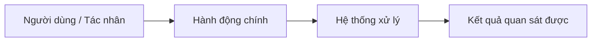

# Đề xuất thiết kế docs cho AI — <tên dự án>

> Trạng thái: **Chờ review (Cổng 1)**. Chưa tạo file nào trong repo.

## 1. Hiện trạng

| Hạng mục | Phát hiện | Bằng chứng |
|---|---|---|
| Stack (major version) | | `package.json` |
| Lệnh build/test/lint/dev, chạy 1 test | | |
| Greenfield / brownfield | | |
| Tài liệu sẵn có + vị trí đúng/sai công cụ đọc | | |
| File mồ côi / bị ignore / cũ / mâu thuẫn | | |
| Tài liệu nguồn bên ngoài (PRD, docx) | | |
| Cưỡng chế & Sàn chất lượng hiện tại (Ratchets `C23`) | | |
| Quy ước git thực tế | | `git log` |
| Vùng rủi ro & tín hiệu bật Pack (`PK-*`) | | |
| Điều kiện hạ tầng bên ngoài có thể chặn AC | | |
| Công cụ AI team dùng | | |

## 2. Mức đề xuất

- Base: writing-spec-for-ai v1.3.0 · Profile: <S | M | L> — xem `profiles.md` về dấu hiệu và file tối thiểu.
- Pack: <PK-… — tín hiệu: …> — xem `packs/PK-….md` về tín hiệu bật và REQ.
- Mức 0: toàn bộ (0.1–0.18 / `C01–C29`).
- Mức 1: <thành phần> — tín hiệu: <…>
- Mức 2: <thành phần> — tín hiệu: <…>

## 3. Cây file đề xuất

```
AGENTS.md
CONSTRAINTS.md                    # Profile M/L: sàn chất lượng & ratchets (C23)
CLAUDE.md                         # adapter
.github/copilot-instructions.md   # adapter (nếu dùng Copilot)
docs/glossary.md
docs/decisions.md
docs/reference/config.md
docs/reference/error-codes.md
docs/specs/README.md
docs/specs/_template.md
docs/specs/00-<khu-vực>.md        # Draft / As-built
docs/progress.md
docs/plans/                       # mức 1
docs/changes/                     # mức 1, brownfield
.agents/skills/<tên>/SKILL.md     # mức 2
```

| File | Mục đích | Nội dung chính | Tạo / sửa / di chuyển / xoá |
|---|---|---|---|

## 4. Nội dung dự kiến của AGENTS.md & CONSTRAINTS.md

- **Lệnh (gồm lệnh chạy 1 test):**
- **Context Pointers (`C24` — "Khi chạm X → đọc Y"):**
- ✅ **Luôn (`C27` ceiling marker):**
- ⚠️ **Hỏi trước:**
- 🚫 **Không bao giờ (`C23` floor guard):**
- **DoD & Sàn `CONSTRAINTS.md`:**
- **File mẫu để bắt chước:**
- **Luật chuyển xuống phạm vi:** <thư mục → luật>

## 5. Trực quan hoá Định hướng, Bản đồ Năng lực & Spec dự kiến (`C28` — Capability Map)

### 5.1 Scope Radar (`🟢 Làm ngay / 🟡 Đợt kế / 🔴 Không làm` — `C28`)

| 🟢 Làm ngay (MVP — GĐ 1) | 🟡 Đợt kế tiếp (Phase 2) | 🔴 Không làm (Out of Scope) |
|---|---|---|
| - <Hành vi cốt lõi 1> | - <Mở rộng sang GĐ 2> | - <Thứ loại bỏ rõ ràng để AI không làm thừa> |

### 5.2 Luồng tương tác tổng thể & Phương án trực quan (`Visual Option Cards` — `C28`)



<!-- Nếu định hướng sản phẩm/kiến trúc còn mở (≥ 2 hướng), trình bày 2–3 Phương án trực quan kèm Snapshot I/O (ASCII wireframe / CLI / JSON mẫu) để người dùng chọn trước khi viết spec. Xoá khối Option Cards nếu chỉ có 1 hướng duy nhất. -->
- **Phương án A (Khuyến nghị):** <Mô tả 1 dòng + ASCII wireframe / mẫu I-O + ưu/nhược>
- **Phương án B:** <Mô tả 1 dòng + ASCII wireframe / mẫu I-O + ưu/nhược>

### 5.3 Bản đồ Năng lực (`Capability Map` — Chiều phụ thuộc chỉ đi một chiều `Depends on`, cấm vòng lặp)

| ID | Khu vực | Trách nhiệm | Phụ thuộc vào (`Depends on`) | Trạng thái dự kiến | Nguồn yêu cầu |
|---|---|---|---|---|---|
| SPEC-ARCH | Kiến trúc & nguyên tắc | | — | Draft / As-built | |

- **Thứ tự xây dựng (`Build Order`):** `SPEC-ARCH → ...`
- **REQ kế thừa từ Pack (`PK-*`):**

| Spec | Kế thừa từ Pack | Tham số `{…}` điền giá trị |
|---|---|---|

## 6. Thuật ngữ cần chốt (`glossary.md`)

## 7. Cưỡng chế, hook, skill dự án (`verify-<app>`)

| Thành phần | Luật/quy trình | Tín hiệu |
|---|---|---|

## 8. Kế hoạch thử tài liệu (Bước 7 — `doc-tester`)

| Task mẫu | Kiểm điều gì |
|---|---|
| 1. Thường gặp: <…> | Context pointer dẫn tới đúng spec và lệnh chạy 1 test |
| 2. Chạm ranh giới: <…> | Dừng hỏi ở mục ⚠️ Hỏi trước / từ chối mục 🚫 |
| 3. Mơ hồ cố ý: <…> | Dừng nêu `[CẦN LÀM RÕ]` kèm phương án, không tự bịa |

## 9. Cố ý không làm

## 10. Làm rõ theo `HYPOTHESIS + Frontier + GUESS`

- **HYPOTHESIS (Giả thuyết hiện tại):** <1–2 câu tóm tắt mục tiêu, phạm vi và ràng buộc chính của dự án theo bằng chứng khảo sát.>
- **CONFIDENCE:** `<XX>%` — Còn khuyết: <những điểm chưa có bằng chứng>.

<!-- Chỉ hỏi tối đa ≤ 5 câu thuộc Mặt trận (Frontier), câu ảnh hưởng kiến trúc lớn nhất đứng đầu. -->

1. **[CẦN LÀM RÕ]** <Câu hỏi 1>
   - ➡️ **Đề xuất (`GUESS`):** <Phương án khuyến nghị + lý do>
   - **Hệ quả nếu chọn khác:** <…>
