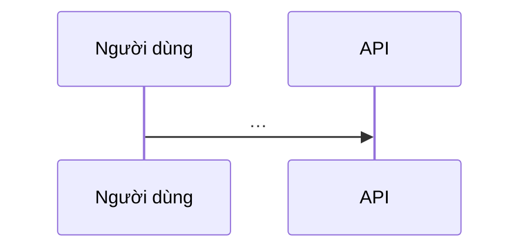

# SPEC-XXX — Thiết kế

Dùng khi spec cần > 2 PR hoặc chạm schema / API công khai / bảo mật. Spec nói *cái gì*; file này nói *ghép thế nào*.

Khái niệm mượn: Module sâu (Deep Module) & Thiết kế hai lần (Design It Twice) — John Ousterhout, *A Philosophy of Software Design*; Điểm ghép nối (Seam) — Michael Feathers, *Working Effectively with Legacy Code*; STRIDE — Microsoft (Kohnfelder & Garg, 1999); Mở rộng → Chuyển → Thu gọn (Expand–Migrate–Contract / Parallel Change) — Danilo Sato, martinfowler.com/bliki/ParallelChange.html.

Mỗi cơ chế hoặc quyết định thiết kế đáng kể bắt buộc giải thích bằng thẻ dưới đây để người đọc **hiểu rõ bản chất kỹ thuật** và **nghiệm thu bằng bước "Tự kiểm"** (không duyệt mù chỉ vì văn xuôi nghe hợp lý; lời duyệt không chứng nhận phần "cần chuyên gia"):

```
**Khái niệm / Quyết định:** <…> · Nhãn: <Người dùng chốt | Đã xác minh | AI đề xuất | Chưa biết>
- **Bản chất là gì (nói dễ hiểu + ví dụ thực tế):** <Giải thích bằng lời thường kèm ví dụ gắn với bài toán; không chỉ ném thuật ngữ>
- **Tại sao bắt buộc cần ở đây (nếu không có thì lỗi gì xảy ra?):** <Kịch bản hỏng quan sát được nếu bỏ qua hoặc chọn sai>
- **Chạy thế nào trong dự án này (Đầu vào → Xử lý → Đầu ra):** <2–3 bước cụ thể trong luồng thiết kế>
- **Tự kiểm trong ≤ 5 phút:** <lệnh/thao tác + kết quả mong đợi, trỏ AC-ID>
- **Nguồn & Không tự kiểm được:** <con trỏ mở được + trích nguyên văn; bảo mật/thanh toán/pháp lý/dữ liệu cá nhân → "cần chuyên gia: <vai trò>"; hoặc "Không có">
```

**Nhãn nguồn gốc:** `Người dùng chốt` — kèm ngày/câu nói · `Đã xác minh` — kèm đúng 1 con trỏ mở được (`path:line`, URL + trích nguyên văn + ngày đọc, hoặc lệnh + kết quả thật) · `AI đề xuất` — lý do 1 dòng + hậu quả nếu sai · `Chưa biết` — cách xác minh + ai + phần bị chặn.

| Thuộc tính | Giá trị |
|---|---|
| Spec | SPEC-XXX |
| Trạng thái | Draft |

## 1. Bối cảnh và ràng buộc

<Ràng buộc từ `decisions.md` (D-xx), `CONSTRAINTS.md`, `AGENTS.md`, hạ tầng. Không chép lại REQ của spec.>

## 2. Thiết kế Module Sâu & Điểm ghép nối (`Deep Modules & Seams`)



| Thành phần (Module) | Giao diện & Điểm ghép nối (`Interface & Seam`) | Trách nhiệm ẩn bên trong (`Depth`) | REQ | Nguồn chính thống / Trần giới hạn (`ceiling`) |
|---|---|---|---|---|
| `<Tên module>` | `<Hàm/route công khai + Seam đặt bài test>` | `<Logic phức tạp được che giấu>` | XXX-R01 | `<Link docs chính thức version X>` / `ceiling: <ngưỡng → đường nâng cấp>` |

## 3. Mô hình dữ liệu & Migration (Expand–Migrate–Contract)

| Thực thể | Trường chính | Ràng buộc | Vòng đời |
|---|---|---|---|

<!-- Nếu sửa schema đang chạy: nêu rõ 3 bước Expand → Migrate → Contract (Mở rộng → Chuyển dữ liệu, gồm bước kiểm chứng → Thu gọn) (PK-DB-R01). -->

## 4. Hợp đồng

<Link tới file máy đọc: `openapi.yaml#/paths/...`, JSON Schema, test vectors. Không chép nội dung vào đây.>

## 5. Mô hình đe doạ <!-- bắt buộc với vùng rủi ro auth/phân quyền/dữ liệu cá nhân/thanh toán/agent -->

| Tài sản | Mối đe doạ (STRIDE) | Biện pháp | REQ/AC |
|---|---|---|---|

## 6. Phương án đã loại (`Design It Twice`)

<!-- So sánh ít nhất 2 phương án có hình thái giao diện khác nhau. -->

| Phương án | Độ sâu giao diện (`Interface Depth`) & Độ cô lập (`Locality`) | Lý do loại |
|---|---|---|

## 7. Rủi ro, migration, rollback

## 8. Đối chiếu nguyên tắc

| Nguyên tắc (`AGENTS.md` / `CONSTRAINTS.md` / `D-xx`) | Đạt / vi phạm + lý do |
|---|---|

## 9. Câu hỏi mở
