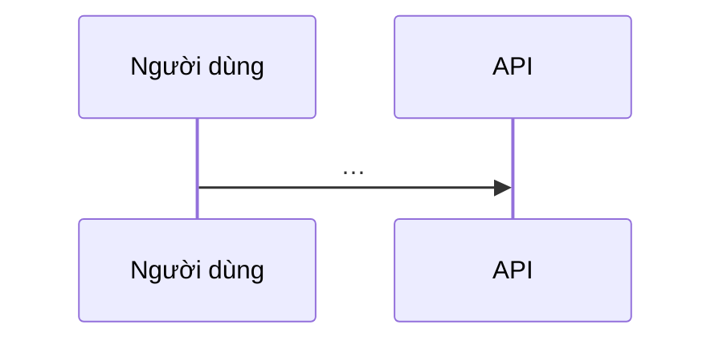

# SPEC-XXX — Thiết kế

Dùng khi spec cần > 2 PR hoặc chạm schema / API công khai / bảo mật. Spec nói *cái gì*; file này nói *ghép thế nào*.

| Thuộc tính | Giá trị |
|---|---|
| Spec | SPEC-XXX |
| Trạng thái | Draft |

## 1. Bối cảnh và ràng buộc

<Ràng buộc từ decisions, AGENTS.md, hạ tầng.>

## 2. Thiết kế

| Thành phần | Trách nhiệm | REQ |
|---|---|---|

## 3. Mô hình dữ liệu

| Thực thể | Trường chính | Ràng buộc | Vòng đời |
|---|---|---|---|

## 4. Hợp đồng

<Link tới file máy đọc: `openapi.yaml#/paths/...`, JSON Schema, test vectors. Không chép nội dung vào đây.>

## 5. Mô hình đe doạ <!-- vùng rủi ro -->

| Tài sản | Mối đe doạ (STRIDE) | Biện pháp | REQ/AC |
|---|---|---|---|

## 6. Phương án đã loại

| Phương án | Lý do loại |
|---|---|

## 7. Rủi ro, migration, rollback

## 8. Đối chiếu nguyên tắc

| Nguyên tắc (AGENTS.md / D-xx) | Đạt / vi phạm + lý do |
|---|---|

## 9. Câu hỏi mở
