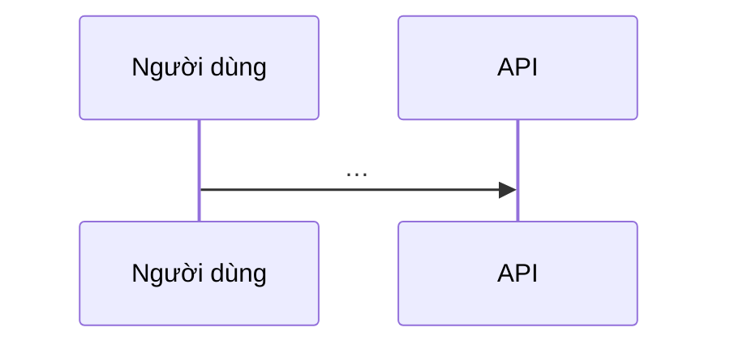

# SPEC-XXX — Thiết kế

Dùng khi spec cần > 2 PR hoặc chạm schema / API công khai / bảo mật. Spec nói *cái gì*; file này nói *ghép thế nào*.

| Thuộc tính | Giá trị |
|---|---|
| Spec | SPEC-XXX |
| Trạng thái | Draft |

## 1. Bối cảnh và ràng buộc

<Ràng buộc từ `decisions.md` (D-xx), `CONSTRAINTS.md`, `AGENTS.md`, hạ tầng. Không chép lại REQ của spec.>

## 2. Thiết kế Module Sâu & Điểm ghép nối (`Deep Modules & Seams`)

| Thành phần (Module) | Giao diện & Điểm ghép nối (`Interface & Seam`) | Trách nhiệm ẩn bên trong (`Depth`) | REQ | Nguồn / Trần (`C25` / `C27`) |
|---|---|---|---|---|
| `<Tên module>` | `<Hàm/route công khai + Seam đặt bài test>` | `<Logic phức tạp được che giấu>` | XXX-R01 | `<Link docs chính thức version X>` / `ceiling: <ngưỡng → đường nâng cấp>` |

## 3. Mô hình dữ liệu & Migration (`Expand–Contract`)

| Thực thể | Trường chính | Ràng buộc | Vòng đời |
|---|---|---|---|

<!-- Nếu sửa schema đang chạy: nêu rõ 4 bước Expand → Migrate → Verify → Contract (PK-DB-R01). -->

## 4. Hợp đồng

<Link tới file máy đọc: `openapi.yaml#/paths/...`, JSON Schema, test vectors. Không chép nội dung vào đây.>

## 5. Mô hình đe doạ <!-- bắt buộc với vùng rủi ro auth/phân quyền/dữ liệu cá nhân/thanh toán/agent -->

| Tài sản | Mối đe doạ (STRIDE) | Biện pháp | REQ/AC |
|---|---|---|---|

## 6. Phương án đã loại (`Design It Twice`)

<!-- So sánh ít nhất 2 phương án có hình thái giao diện khác nhau. -->

| Phương án | Độ sâu giao diện (`Interface Depth`) & Độ cô lập (`Locality`) | Lý do loại |
|---|---|---|

## 7. Rủi ro, migration, rollback

## 8. Đối chiếu nguyên tắc

| Nguyên tắc (`AGENTS.md` / `CONSTRAINTS.md` / `D-xx`) | Đạt / vi phạm + lý do |
|---|---|

## 9. Câu hỏi mở
