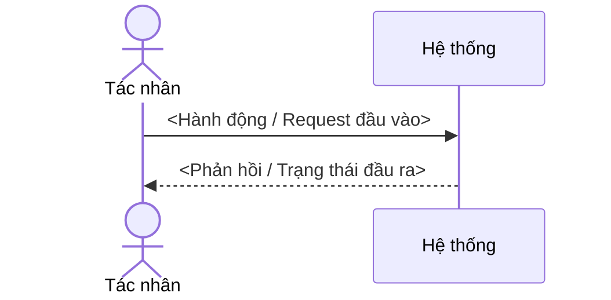

# SPEC-XXX — Tiêu đề

| Thuộc tính | Giá trị |
|---|---|
| Trạng thái | Draft <!-- Draft → Ready → In progress → Done; hoặc As-built (đặc tả hiện trạng code có sẵn) --> |
| Giai đoạn | 1 |
| Phụ thuộc | SPEC-… |
| Quyết định liên quan | D-… |
| Thiết kế | <!-- link *-design.md nếu có --> |

## Bản đọc ngắn để duyệt hành vi

- **Sau thay đổi, ai làm được gì:** <một kết quả quan sát được>.
- **Ví dụ để tự kiểm:** <đầu vào/thao tác → kết quả mong đợi, trỏ AC-ID>. Ưu tiên ví dụ do người dùng đưa: nếu AI viết cả kỳ vọng lẫn test, test xanh chỉ chứng minh code khớp kỳ vọng của AI.
- **Chưa làm trong lần đầu:** <các hành vi lân cận bị loại>.
- **Điều chưa biết & hệ quả:** <điều chưa chứng minh, ảnh hưởng, ai/cách kiểm; hoặc Không có>.
- **Phần người dùng chốt:** <hành vi, phạm vi, đánh đổi>; chi tiết kỹ thuật xem nguồn bên dưới.
- **Giải thích kiến thức & quyết định kỹ thuật:** <xem thẻ giải thích ở §9; giải thích rõ bản chất theo dữ liệu thật của dự án để người đọc hiểu và có dòng "Tự kiểm" chạy trong ≤ 5 phút>.
- **Biên bản phản biện độc lập trước khi trình:** <Chế độ đã chạy: `Chéo model (<model viết> → <CLI model phản biện>)` hoặc `Phiên sạch cùng model (spec-challenger — lý do chưa chạy khác model)` · Đã tự sửa: `...` · Không sửa / Cần người dùng quyết: `...` (cấm giấu phát hiện)>.
- **Quyền chạy:** `Ready` chưa cấp quyền code; đợt được giao nằm ở `../progress.md`.

## 1. Mục tiêu

<Vấn đề, cho ai, đo thành công bằng gì.>

## 2. Phạm vi

**Trong phạm vi:**
**Ngoài phạm vi:** <!-- không được rỗng -->

## 3. Luồng tương tác, ví dụ đầu vào/đầu ra & kịch bản người dùng

- **US1 (P1)** — Là <vai trò>, tôi muốn <…> để <…>. Kiểm độc lập: <…>. AC: XXX-AC01..AC03.

### Luồng tương tác chính (sơ đồ Mermaid)



### Ví dụ cụ thể đầu vào / đầu ra (Concrete I/O Snapshot)

<!-- Vẽ ASCII UI wireframe (nếu có màn hình), mẫu lệnh + output CLI, hoặc JSON request/response thực tế để lập trình viên nhìn thấy ngay hình hài tính năng. -->
```text
+-------------------------------------------------------------------+
| [Tiêu đề màn hình / Lệnh CLI / Endpoint POST /api/v1/...]         |
| Input:  { ... }                                                   |
| Output: { ... } (Trạng thái UI / DB thay đổi gì)                  |
+-------------------------------------------------------------------+
```

## 4. Yêu cầu

| ID | Mức | Yêu cầu | Nguồn gốc |
|---|---|---|---|
| XXX-R01 | MUST | Khi <sự kiện>, hệ thống MUST <…>. | Người dùng chốt — <ngày/câu nói hoặc §11 Làm rõ> |
| XXX-R02 | MUST | Nếu <điều kiện lỗi>, thì hệ thống MUST <…>. | Đã xác minh — `<path:line>` · hoặc AI đề xuất — <lý do; nếu sai thì…> |

**Nhãn nguồn gốc** (nguồn & giới hạn hiểu biết; một khẳng định một dòng, không tự chấm %): `Người dùng chốt` — kèm ngày/câu nói hoặc mục Làm rõ · `Đã xác minh` — kèm đúng 1 con trỏ mở được: `path:line` | URL + trích nguyên văn + ngày đọc | lệnh + kết quả thật · `AI đề xuất` — lý do 1 dòng + hậu quả nếu sai · `Chưa biết` — cách xác minh + ai + phần bị chặn.

<!-- Mẫu EARS: Luôn / Khi <sự kiện> / Trong khi <trạng thái> / Nếu <lỗi> thì / Khi bật <tính năng>. Chỗ chưa rõ: [CẦN LÀM RÕ: …] -->

### Kế thừa từ Domain Pack (`PK-*`) <!-- xoá tiểu mục này nếu spec không kế thừa pack -->

| REQ dự án | Kế thừa từ Pack | Tham số `{…}` điền giá trị / Ghi đè |
|---|---|---|
| XXX-R03 | `PK-API-R01` | `{error-code-doc}` = `docs/reference/error-codes.md` |

## 5. Yêu cầu phi chức năng

| Khía cạnh | Điều kiện kiểm được / `N/A — lý do` / `Chưa biết — P-xx` | Nhãn nguồn gốc & cách kiểm |
|---|---|---|
| Hiệu năng | | |
| Bảo mật (dữ liệu nhạy cảm, quyền, cấm log) | | |
| Giới hạn / rate limit | | |
| Khả dụng / khôi phục | | |
| Quan sát (log, metric, audit) | | |
| i18n | | |
| a11y | | |
| Trạng thái UI (loading / empty / error / forbidden) | | |

<!-- Không lấy số ví dụ làm cam kết. Số đo phải kèm tải/môi trường/ngày; tiêu chuẩn hoặc docs API không chứng minh sản phẩm đạt chuẩn. Draft được ghi Chưa biết, kèm phần bị chặn và cách đóng. -->

## 6. Trường hợp biên

- <câu hỏi biên> → XXX-AC0n | ngoài phạm vi

## 7. Điều kiện nghiệm thu & bảng kiểm thử

| Trạng thái | ý nghĩa |
|---|---|
| `[ ]` | chưa đạt |
| `[x]` | test xanh và có bằng chứng lệnh/kết quả; có CI thì trong PR làm AC đó (bảng bằng chứng chạy test) |
| `[~]` | chưa kiểm chứng — ghi lý do, người/cách đóng; chặn `Done` |

### Bảng kiểm thử — duyệt trước khi code (Visible Test Matrix)

| Mã AC | Kịch bản (`Cho / Khi / Thì`) | Đầu vào cụ thể | Kỳ vọng quan sát được (đầu ra & tác dụng phụ) | Tầng & độ thật (`0 Mock` hay mock thành phần nào) | Trạng thái |
|---|---|---|---|---|---|
| **XXX-AC01** | Nhánh chính: <…> | `<payload / tham số / thao tác>` | `<HTTP 200 + body / bản ghi DB / trạng thái DOM>` | `integration` — **0 Mock** (DB thật) | `[ ]` |
| **XXX-AC02** | Nhánh lỗi / biên: <…> | `<input lỗi / vượt ngưỡng>` | `<HTTP 4xx + errorCode / không ghi DB>` | `unit` / `integration` — **Mock:** `<nêu rõ hoặc 0 Mock>` | `[ ]` |

## 8. Kiểm tra end-to-end

<Lệnh hoặc kịch bản để agent tự xác nhận toàn bộ spec chạy.>

## 9. Ghi chú thiết kế

<Chỉ ràng buộc kiến trúc. Chi tiết thiết kế ở file design. Không chia việc ở đây — thuộc plan.>

### Giải thích kiến thức & quyết định kỹ thuật (Thẻ giải thích kỹ thuật)

<!-- Bắt buộc có ít nhất 1 thẻ hiển thị tường minh (KHÔNG ẩn trong comment, KHÔNG ghi "không có / CRUD chuẩn" để lách) cho cơ chế, ràng buộc dữ liệu, ngưỡng NFR hoặc quyết định kỹ thuật của spec này. Phải giải thích gắn với thực thể/luồng thật của dự án (cấm chép ví dụ chung chung từ glossary); người đọc hiểu rõ bản chất và nghiệm thu tính đúng bằng bước "Tự kiểm". -->

**Khái niệm / Quyết định 1:** `<Tên cơ chế / ràng buộc / quyết định kỹ thuật trong spec này>` · Nhãn: `<Người dùng chốt | Đã xác minh | AI đề xuất | Chưa biết>`
- **Bản chất là gì (nói dễ hiểu + ví dụ thực tế của dự án):** <Giải thích bằng lời thường kèm 1 ví dụ dùng đúng tên bảng/API/màn hình của dự án đang làm; cấm chỉ nêu tên thuật ngữ tiếng Anh hoặc chép ví dụ mẫu>
- **Tại sao bắt buộc cần ở đây (nếu không có thì lỗi gì xảy ra?):** <Kịch bản hỏng quan sát được trên dữ liệu/người dùng của dự án nếu bỏ qua cơ chế này>
- **Chạy thế nào trong dự án này (Đầu vào → Xử lý → Đầu ra):** <2–3 bước ngắn mô tả dữ liệu đi vào, biến đổi gì, trả ra gì>
- **Tự kiểm trong ≤ 5 phút:** <Lệnh hoặc thao tác + kết quả mong đợi, trỏ `AC-ID` để người dùng tự kiểm chứng>
- **Nguồn đối chiếu & Giới hạn không tự kiểm được:** <Con trỏ mở được + trích nguyên văn; vùng bảo mật/thanh toán/pháp lý/dữ liệu cá nhân → ghi "cần chuyên gia: <vai trò>"; hoặc "Không có">

## 10. Hướng dẫn vận hành <!-- tuỳ chọn; dành cho người vận hành, không phải REQ -->

## 11. Làm rõ

<!-- ### Phiên YYYY-MM-DD
- H: … → Đ: … (ghi vào R0n / D-xx) -->

## 12. Câu hỏi mở

<!-- Ghi "Không có" nếu rỗng. Mâu thuẫn với spec khác: ghi ở cả hai spec. -->

| Điều chưa biết / đề xuất | Nguồn đã kiểm | Ảnh hưởng / AC bị chặn | Cách xác minh & người phụ trách |
|---|---|---|---|
| <P-xx hoặc câu hỏi> | <bằng chứng hoặc Chưa có> | <phần phụ thuộc; không chặn phần độc lập> | <nghiên cứu/thử nghiệm được phép/chuyên gia> |
